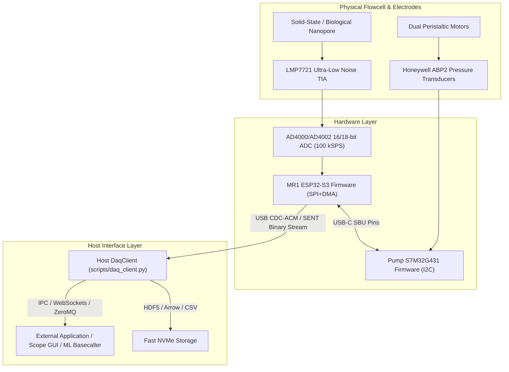
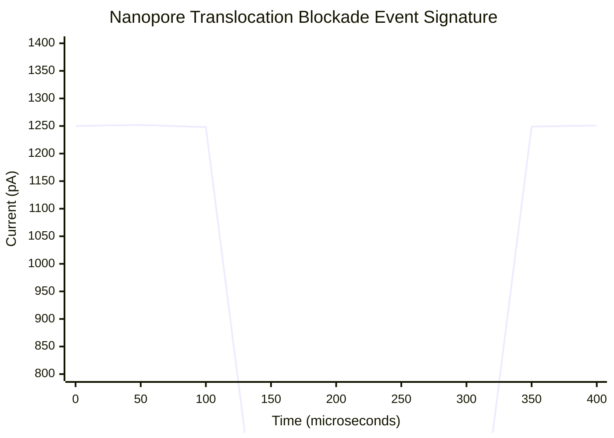

# MR1 Nanopore Reader — High-Speed Streaming DAQ & External Interfacing Specification

**Document Version:** 1.0.0  
**Status:** Approved for External Integration  
**Date:** 2026-09-30  
**Target Systems:** MR1 ESP32-S3 Nanopore Reader, MR1 STM32G431 Pump Controller, Host DaqClient (`src/daq_client.py`), and External Visualization / Downstream Analysis Programs.

---

## 1. Executive Summary

This document specifies the communication architecture, binary packet formats, telemetry contracts, IPC (Inter-Process Communication) streaming protocols, and event-detection data structures for the MR1 Nanopore Sequencing platform.

Downstream programs (such as real-time oscilloscope GUIs, machine-learning basecallers, and automated flowcell controllers) can interface with the reader either:
1. **Directly over USB CDC-ACM** at $12\text{ Mbps}$ Full-Speed / $480\text{ Mbps}$ High-Speed USB.
2. **Via the Host DAQ Bridge (`src/daq_client.py`)** over WebSockets, Named Pipes (Windows), or Unix Domain Sockets (Linux/macOS).
3. **Via ZeroMQ PUB/SUB or Shared Memory Ring Buffers** for zero-copy, sub-millisecond latency processing at $100\text{ kSPS}$.



---

## 2. Physical & Transport Layer Protocol (USB CDC-ACM)

### 2.1 Transport Framing
The primary data stream operates over USB CDC-ACM at 12 Mbps Full-Speed. Telemetry and commands utilize 7-bit ASCII/JSON with `\n` line termination, while raw high-speed sensor streams utilize binary framing with the fixed magic header `SENT` (`0x53 0x45 0x4E 0x54`).

### 2.2 Binary Stream Frame Structure (`StreamFrame`)
Binary packets are emitted continuously at $1{,}562.5\text{ Hz}$ when streaming is active. Each packet encapsulates 64 consecutive ADC current samples ($100\text{ kSPS}$ aggregate rate) in a 146-byte packed Little-Endian struct with CRC-16-CCITT integrity verification:

```
 0                   1                   2                   3
 0 1 2 3 4 5 6 7 8 9 0 1 2 3 4 5 6 7 8 9 0 1 2 3 4 5 6 7 8 9 0 1
+-+-+-+-+-+-+-+-+-+-+-+-+-+-+-+-+-+-+-+-+-+-+-+-+-+-+-+-+-+-+-+-+
|                      magic: 'S' 'E' 'N' 'T'                   | (0x53454E54)
+-+-+-+-+-+-+-+-+-+-+-+-+-+-+-+-+-+-+-+-+-+-+-+-+-+-+-+-+-+-+-+-+
|                         frame_index                           | (uint32)
+-+-+-+-+-+-+-+-+-+-+-+-+-+-+-+-+-+-+-+-+-+-+-+-+-+-+-+-+-+-+-+-+
|                        timestamp_us                           | (uint32)
+-+-+-+-+-+-+-+-+-+-+-+-+-+-+-+-+-+-+-+-+-+-+-+-+-+-+-+-+-+-+-+-+
|         sample_count          |         status_flags          | (uint16, uint16)
+-+-+-+-+-+-+-+-+-+-+-+-+-+-+-+-+-+-+-+-+-+-+-+-+-+-+-+-+-+-+-+-+
|          sample[0]            |          sample[1]            | (int16 signed)
+-+-+-+-+-+-+-+-+-+-+-+-+-+-+-+-+-+-+-+-+-+-+-+-+-+-+-+-+-+-+-+-+
|                             ...                               |
+-+-+-+-+-+-+-+-+-+-+-+-+-+-+-+-+-+-+-+-+-+-+-+-+-+-+-+-+-+-+-+-+
|          sample[62]           |          sample[63]           | (int16 signed)
+-+-+-+-+-+-+-+-+-+-+-+-+-+-+-+-+-+-+-+-+-+-+-+-+-+-+-+-+-+-+-+-+
|             crc16             | (uint16 CCITT)
+-+-+-+-+-+-+-+-+-+-+-+-+-+-+-+-+
```

| Offset (Bytes) | Field Name | Data Type | Description |
| :--- | :--- | :--- | :--- |
| `0..3` | `magic` | `uint32_t` | Constant sync word: `0x53454E54` (`"SENT"` in ASCII) |
| `4..7` | `frame_index` | `uint32_t` | Monotonically increasing packet sequence counter (drop detection) |
| `8..11` | `timestamp_us` | `uint32_t` | Hardware microsecond timer synchronized to ADC conversion start |
| `12..13` | `sample_count` | `uint16_t` | Number of samples in payload (Nominal = 64) |
| `14..15` | `status_flags` | `uint16_t` | Hardware bitmask (`b0`=Active, `b1`=Leak, `b2`=Pump Conn, `b3`=Pump Run, `b4`=Pump Estop) |
| `16..143` | `samples[64]` | `int16_t[64]` | 64 signed differential ADC conversion codes ($\pm 32768 = \pm 2.048\text{ V}$) |
| `144..145` | `crc16` | `uint16_t` | CRC-16-CCITT (`0x1021`, init `0xFFFF`) calculated over bytes `0..143` |

> [!NOTE]
> Physical variables that update at slower rates (applied bias voltage, ambient temperature, Cis/Trans fluid pressures) are communicated out-of-band via the 10 Hz Telemetry JSON channel or SBU link, preserving maximum USB throughput and zero sample jitter for the 100 kHz electrophysiology stream.

### 2.3 Physical Current Conversion Equation
To compute the true ionic nanopore current $I_{pore}$ in Amperes from the 16-bit signed integer $S_{adc}$:

$$V_{adc} = S_{adc} \cdot \left(\frac{V_{ref}}{2^{15}}\right) = S_{adc} \cdot \left(\frac{2.048\text{ V}}{32768}\right) = S_{adc} \cdot 62.5\,\mu\text{V}$$

$$I_{pore} = \frac{V_{adc}}{R_{feedback}} = \frac{S_{adc} \cdot 62.5 \times 10^{-6}\text{ V}}{1.0 \times 10^9\,\Omega} = S_{adc} \cdot 62.5\text{ fA}$$

- **Current Resolution:** $62.5\text{ fA/LSB}$ (with $1\text{ G}\Omega$ feedback resistor).
- **Full-Scale Dynamic Range:** $\pm 2.048\text{ nA}$.
- **RMS Noise Floor:** $< 1.2\text{ pA RMS}$ at $10\text{ kHz}$ bandwidth on PTFE interposer with driven guard ring.

---

## 3. Host IPC & Downstream Program Interfaces

To decouple the real-time USB hardware acquisition from external applications, `scripts/daq_client.py` exposes multiple standardized IPC endpoints:

### 3.1 WebSocket Interface (`ws://localhost:8765/stream`)
Ideal for web-based oscilloscopes, Electron apps, and Python/JavaScript frontends.

#### Message Types:
1. **Telemetry JSON (Sent @ 10 Hz):**
   ```json
   {
     "type": "telemetry",
     "timestamp": 1727731200.123,
     "bias_mv": 180.0,
     "temperature_c": 24.85,
     "cis_pressure_psi": 2.45,
     "trans_pressure_psi": 0.82,
     "weep_leak_detected": false,
     "flow_rate_cis_ul_min": 15.0,
     "mean_baseline_pa": 1245.8,
     "rms_noise_pa": 1.18,
     "packets_received": 62500,
     "packets_dropped": 0
   }
   ```
2. **Binary Frame Chunk (Sent @ 100 Hz, 1000 samples per message):**
   - Header: 8-byte microsecond timestamp.
   - Body: Array of float32 current values in picoamperes ($1000 \times 4\text{ bytes} = 4000\text{ bytes}$).

3. **External Command Message (Bidirectional):**
   ```json
   {
     "cmd": "set_bias",
     "bias_mv": 200.0
   }
   ```
   ```json
   {
     "cmd": "set_pump",
     "pump_id": 1,
     "rate_ul_min": 25.0,
     "direction": "FORWARD"
   }
   ```
   ```json
   {
     "cmd": "emergency_stop",
     "reason": "USER_ABORT"
   }
   ```

### 3.2 High-Throughput ZeroMQ PUB/SUB Socket (`ipc:///tmp/mr1_stream.ipc`)
For low-latency scientific computing, C++ / Rust / Julia analytics, and real-time deep learning basecallers:
- **Topic `raw_100k`:** Raw binary `StreamFrame` structs published directly without serialization overhead.
- **Topic `events`:** Real-time detected translocation event objects.

### 3.3 Named Pipe / Unix Domain Socket (`\\.\pipe\mr1_daq`)
Zero-configuration inter-process communication supported natively on Windows and POSIX platforms.

---

## 4. Nanopore Translocation Event Data Model

When macromolecules (DNA, RNA, proteins) pass through the nanopore lumen, they cause transient blockade events. External programs receiving event streams receive structured JSON or Arrow dictionaries:



### Event Struct Definition
```json
{
  "event_id": 10428,
  "start_timestamp_us": 1849204859,
  "duration_us": 185.4,
  "baseline_current_pa": 1250.2,
  "blockade_current_pa": 320.5,
  "blockade_depth_pa": 929.7,
  "fractional_blockade": 0.7436,
  "area_pa_us": 172350.0,
  "trans_pressure_mbar": 12.4,
  "dwell_time_us": 185.4,
  "sublevel_count": 1,
  "raw_waveform_slice": [1249.8, 1248.5, 950.2, 325.4, 318.2, 320.1, ..., 1250.4]
}
```

---

## 5. Downstream Application Integration Guide

### Step 1: Launch MR1 Acquisition Bridge
```bash
# In mr1 repository root:
python scripts/daq_client.py --port COM5 --baud 2000000 --stream-ipc
```

### Step 2: Minimal Python Integration Example
External applications can ingest data in less than 20 lines of code:

```python
import asyncio
import websockets
import json

async def monitor_nanopore():
    uri = "ws://localhost:8765/stream"
    async with websockets.connect(uri) as ws:
        # Subscribe to telemetry & events
        await ws.send(json.dumps({"cmd": "subscribe", "channels": ["telemetry", "events"]}))
        while True:
            msg = await ws.recv()
            data = json.loads(msg)
            if data.get("type") == "event":
                print(f"[EVENT #{data['event_id']}] Dwell: {data['duration_us']} us | Depth: {data['blockade_depth_pa']} pA")
            elif data.get("type") == "telemetry":
                print(f"[STATUS] I_base: {data['mean_baseline_pa']} pA | Cis P: {data['cis_pressure_psi']} psi")

if __name__ == "__main__":
    asyncio.run(monitor_nanopore())
```

---

## 6. Error Handling & Failsafe States

1. **Buffer Overrun Handling:** If a downstream application falls behind, the host DAQ buffer uses a fixed-size ring buffer ($100{,}000\text{ samples} = 1\text{ second}$). If capacity reaches $95\%$, the client sets `packets_dropped` in telemetry and drops oldest visualization chunks while preserving raw disk recordings.
2. **Emergency Cutoff Relay:** If an external program sends `{"cmd": "emergency_stop"}`, the Host DAQ immediately issues the hardware cutoff command to the MR1 and Pump controllers, disabling TIA bias voltage and setting motor PWM duty to 0% in $< 1\text{ ms}$.
3. **Automatic Reconnection:** WebSocket and IPC endpoints support graceful client disconnect and reconnect without interrupting background data logging.
