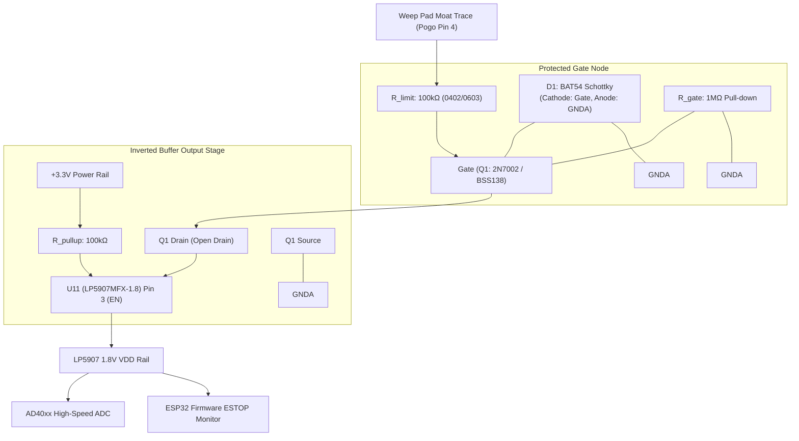

# Engineering Change Order: Weep Sense N-FET Buffer & Negative Excursion Clamp

**ECO Number:** ECO-2026-004  
**Date:** October 2026  
**Status:** Approved / Directive  
**Target Subsystems:**
- Amplifier / MR1 Board (`MR1/Insturmentation.kicad_sch`, `MR1/MR1.kicad_pcb`)
- Linear Voltage Regulator: `U11` (TI LP5907MFX-1.8)
- Interposer Interface: `J_POGO1` Pin 4 (`WEEP_SENSE`)
- Fluidic Safety Interlock: Immediate Hardware Shutdown / Pump Cutoff

---

## 1. Problem Statement & Hazard Analysis

In the **MR1 Nanopore Reader**, the low-noise transimpedance amplifier and pore excitation stage (`PORE_amp`) deliver bidirectional voltages swinging up to $\pm 2.5\text{ V}$ across the working and counter electrodes.

The **Interposer** perimeter features a channel-contouring dual-conductor weep sense moat (`WEEP_SENSE` flanking the $1.4\text{ mm}$ fluid channels and separated by a $0.25\text{ mm}$ gap from the full-board `GNDA` copper flood). If electrolyte (1M KCl) breaches the cast silicone gasket seal, conductive fluid bridges the weep sense moat to `GNDA` or directly contacts the active pore excitation path.

### Critical Vulnerability: Negative Excursion on LDO Enable Pin
- The 1.8V analog supply rail for the AD40xx high-speed ADC is generated by **`U11` (Texas Instruments LP5907MFX-1.8)**.
- Per the Texas Instruments LP5907 datasheet (Doc ID: SNVSA79):
  $$\text{LP5907 EN Pin Absolute Maximum Rating: } -0.3\text{ V to } V_{IN} + 0.3\text{ V } (3.6\text{ V})$$
- If `WEEP_SENSE` is wired directly to `U11` Pin 3 (EN) or unbuffered CMOS logic gates without protection:
  - When `PORE_amp` swings negative (down to $-2.5\text{ V}$ during negative baseline bias or clearing pulses), the $-2.5\text{ V}$ potential will enter the EN pin directly.
  - This **forward-biases the internal substrate ESD protection diodes**, conducting heavy substrate current, inducing CMOS latch-up, and permanently destroying `U11`.

---

## 2. Recommended Circuit Topology

An active **N-channel MOSFET buffer with Schottky negative clamping and series current limiting** is inserted between the `WEEP_SENSE` interface and the LP5907 EN pin (U11 Pin 3):

```text
       Weep Pad Trace (WEEP_SENSE, Interleaved Moat)
                  │
                 [R_limit: 100kΩ] (Limits fault current to ≤ 25 µA)
                  │
                  o─────────────────────────┐
                  │                         │
                 [R_gate: 1MΩ]            [D1: BAT54 / 1N4148]
                  │ (Pull-down)             │ (Cathode to Gate, Anode to GNDA)
                 GNDA                      GNDA
                  │                         │
                  ▼                         ▼
              Gate (N-FET Q1: 2N7002 / BSS138)
            ┌─────┴─────┐
            │           │
     Source │           │ Drain
            │           │
           GNDA         o─────────────────────o── U11 (LP5907) Pin 3 (EN)
                                              │
                                             [R_pullup: 100kΩ]
                                              │
                                             +3V3
```



---

## 3. Theory of Operation & Quantitative Regimes

### Regime 1: Normal Quiescent Dry Operation
- Moat air gap resistance: $R_{dry} > 10\text{ G}\Omega$.
- Gate node is held firmly at $0\text{ V}$ by $R_{gate} = 1\text{ M}\Omega$.
- Gate-source voltage $V_{GS} = 0\text{ V} < V_{GS(th)} \approx 1.5\text{ V}$.
- MOSFET $Q_1$ is **OFF** ($I_{DS} \approx 0$).
- Drain node is pulled up to $+3.3\text{ V}$ through $R_{pullup} = 100\text{ k}\Omega$.
- Pin 3 (EN) sits at $+3.3\text{ V} > V_{EN(high)} = 1.2\text{ V}$.
- **Result:** LP5907 is **ENABLED**, supplying a pristine $1.8\text{ V}$ analog VDD rail to the AD40xx ADC.

### Regime 2: Moisture Breach / Positive Fault ($V_{fault} = +2.5\text{ V}$)
- Saline bridges the $0.25\text{ mm}$ gap to an active electrode or positive pore potential ($+0.1\text{ V}$ to $+2.5\text{ V}$).
- Voltage divider established between $R_{limit}$ and $R_{gate}$:
  $$V_{gate} = V_{fault} \cdot \frac{R_{gate}}{R_{limit} + R_{gate}} = 2.5\text{ V} \cdot \frac{1.0\text{ M}\Omega}{100\text{ k}\Omega + 1.0\text{ M}\Omega} \approx 2.27\text{ V}$$
- Since $V_{gate} = 2.27\text{ V} > V_{GS(th)} \approx 1.5\text{ V}$, $Q_1$ turns **HARD ON**.
- Drain pulls down to `GNDA` ($V_{DS(on)} < 50\text{ mV}$).
- Pin 3 (EN) drops below $V_{EN(low)} = 0.4\text{ V}$.
- **Result:** LP5907 **SHUTS DOWN INSTANTLY**, dropping the $1.8\text{ V}$ rail to $0\text{ V}$. The AD40xx conversions cease, and the firmware triggers an emergency pump cutoff.

### Regime 3: Negative Excursion / Negative Fault ($V_{fault} = -2.5\text{ V}$)
- If `PORE_amp` swings to $-2.5\text{ V}$ during negative baseline biasing or electrode clearing:
- Clamping diode $D_1$ (BAT54) forward-biases with its anode at `GNDA` and cathode at the Gate node.
- The Gate node is clamped safely to:
  $$V_{gate} = -V_F \approx -0.30\text{ V} \text{ (BAT54 Schottky) to } -0.6\text{ V (1N4148)}$$
- Total fault current injected through $R_{limit}$ is strictly limited:
  $$I_{fault} = \frac{|-2.5\text{ V}| - 0.30\text{ V}}{100\text{ k}\Omega} = \frac{2.20\text{ V}}{100\text{ k}\Omega} = 22.0\text{ }\mu\text{A} \le 25\text{ }\mu\text{A}$$
- $Q_1$ gate rating ($\pm 20\text{ V}$) is protected with $> 19\text{ V}$ safety margin.
- Because the N-FET drain is physically isolated from the gate, **zero negative voltage reaches U11 Pin 3**.
- **Result:** U11 Pin 3 sits safely at $+3.3\text{ V}$; the LP5907 absolute maximum rating ($-0.3\text{ V}$) is never violated.

---

## 4. Bill of Materials (BOM)

| Designator | Value / Part | Description | Package | Manufacturer PN |
| :--- | :--- | :--- | :--- | :--- |
| **`Q1`** | **2N7002 / BSS138** | N-Channel MOSFET, $50\text{V}$, $200\text{mA}$, $V_{th} \approx 1.5\text{V}$ | SOT-23 / SOT-323 | ON Semi `2N7002LT1G` / Diodes Inc `BSS138` |
| **`D1`** | **BAT54 / 1N4148** | Low-$V_F$ Schottky Diode ($V_F \le 0.35\text{V}$ at $1\text{mA}$) | SOT-23 / SOD-323 | Diodes Inc `BAT54-7-F` |
| **`R_limit`** | **$100\text{ k}\Omega$, 1%** | Series Current-Limiting Resistor, $1/16\text{W}$ | 0402 / 0603 SMD | Vishay `CRCW0402100KFKED` |
| **`R_gate`** | **$1\text{ M}\Omega$, 5%** | Gate Pull-Down Bleeder Resistor, $1/16\text{W}$ | 0402 / 0603 SMD | Yageo `RC0402JR-071ML` |
| **`R_pullup`** | **$100\text{ k}\Omega$, 1%** | Drain Pull-Up Resistor to $+3\text{V3}$, $1/16\text{W}$ | 0402 / 0603 SMD | Vishay `CRCW0402100KFKED` |

---

## 5. Step-by-Step Board Modification (Rework Directive)

For existing hardware revisions (`MR1` Rev A):

```text
[Existing PCB Trace]
  +3V3 ────[ CUT HERE ✂ ]────> Pin 3 (EN) of U11 (LP5907)
```

1. **Cut Trace Feeding U11 Pin 3:**
   - Locate U11 (SOT-23-5 LP5907MFX-1.8) on the top side of the MR1 Amplifier board.
   - Using a surgical scalpel or precision micro-drill, sever the copper trace linking Pin 3 (EN) to the $+3\text{V3}$ plane.
   - Verify with a multimeter in continuity mode that Pin 3 has $> 10\text{ M}\Omega$ isolation from $+3\text{V3}$.

2. **Mount the Protection Components:**
   - **$R_{limit}$ ($100\text{ k}\Omega$):** Solder one terminal directly to the incoming `WEEP_SENSE` wire/pad (Pogo Pin 4 target trace).
   - **$Q_1$ (2N7002 / BSS138):**
     - Solder Source (Pin 2) directly to the adjacent `GNDA` copper flood.
     - Solder Drain (Pin 3) to U11 Pin 3 (EN).
     - Connect Gate (Pin 1) to the other terminal of $R_{limit}$.
   - **$D_1$ (BAT54):**
     - Solder Cathode to Gate of $Q_1$.
     - Solder Anode to `GNDA`.
   - **$R_{gate}$ ($1\text{ M}\Omega$):**
     - Solder between Gate of $Q_1$ and `GNDA`.
   - **$R_{pullup}$ ($100\text{ k}\Omega$):**
     - Solder between U11 Pin 3 (EN) and the local $+3\text{V3}$ decoupling capacitor pad (`C_in`).

---

## 6. Bench Verification & Validation Protocol

Execute the following four-point bench test suite before operational biological testing:

### Test 1: Cold Continuity & Resistance Check
- **Measurement:** Measure resistance from `WEEP_SENSE` pogo pad to $Q_1$ Gate.
- **Pass Criteria:** $100\text{ k}\Omega \pm 1\%$.
- **Measurement:** Measure resistance from $Q_1$ Gate to `GNDA`.
- **Pass Criteria:** $1.0\text{ M}\Omega \pm 5\%$.

### Test 2: Negative Voltage Excursion Clamping
- **Procedure:** Connect a bench power supply with current limit set to $1\text{ mA}$. Apply $-2.5\text{ V}$ to the `WEEP_SENSE` pad relative to `GNDA`.
- **Measurement:** Measure voltage at $Q_1$ Gate node.
- **Pass Criteria:** $-0.35\text{ V} \le V_{gate} \le -0.25\text{ V}$. Must NOT drop below $-0.40\text{ V}$.
- **Measurement:** Measure current supplied by the bench supply.
- **Pass Criteria:** $I_{fault} \le 25\text{ }\mu\text{A}$ ($22\text{ }\mu\text{A}$ nominal).
- **Measurement:** Measure voltage at U11 Pin 3 (EN).
- **Pass Criteria:** Pin 3 must remain at $+3.3\text{ V}$ nominal ($> 3.0\text{ V}$).

### Test 3: Dry Quiescent State Verification
- **Procedure:** Power the reader board dry via USB-C ($+5\text{V}$ and $+3\text{V3}$ active).
- **Measurement:** Measure U11 Pin 3 (EN) and Pin 5 ($V_{OUT}$).
- **Pass Criteria:**
  - $V_{EN} = 3.3\text{ V} \pm 0.1\text{ V}$.
  - $V_{OUT} = 1.80\text{ V} \pm 0.04\text{ V}$ (nominal AD40xx VDD).

### Test 4: Positive Fault & Electrolyte Breach Interlock Trigger
- **Procedure:** 
  1. Apply $+2.5\text{ V}$ to `WEEP_SENSE` via a $1\text{ k}\Omega$ series resistor, OR deposit a $2\text{ }\mu\text{L}$ droplet of $1\text{ M KCl}$ across the interposer weep sense moat gap to `GNDA`.
  2. Observe U11 Pin 3 and the 1.8V VDD rail on an oscilloscope.
- **Pass Criteria:**
  - $V_{gate}$ jumps to $+2.2\text{ V} - +2.3\text{ V}$.
  - $V_{EN}$ falls to $< 0.1\text{ V}$ within $< 2\text{ }\mu\text{s}$.
  - $V_{OUT}$ drops to $0.0\text{ V}$ ($< 50\text{ mV}$), completely de-energizing the AD40xx and halting conversions.
  - ESP32 firmware detects ADC conversion halt and de-energizes the STM32 pump driver within $10\text{ ms}$.
