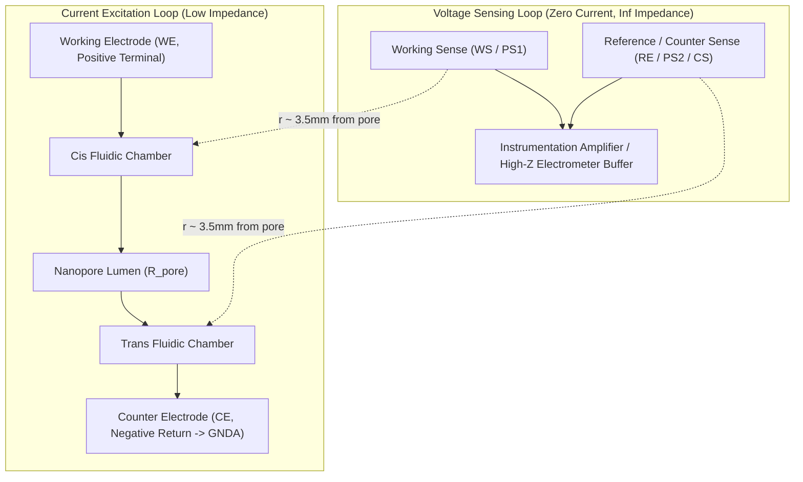
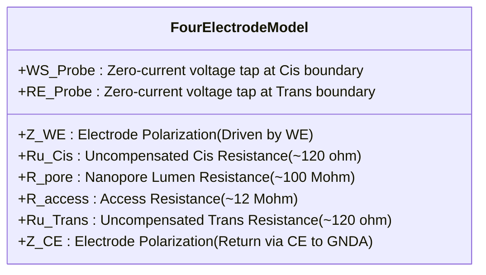

# Interposer Four-Electrode Electrochemical Cell Architecture

**Document Version:** 1.0.0  
**References:**
- ACS Journal of Physical Chemistry C: *"Method of the Four-Electrode Electrochemical Cell"* (J. Phys. Chem. C 2017, 121, 8, 4112–4119) [DOI: 10.1021/acs.jpcc.6b12543]
- Gamry Instruments: *"Two-, Three-, and Four-Electrode Experiments"* (Application Note)
- Target Substrate: 0.8 mm Rogers RO4350B / PTFE ($\epsilon_r = 2.1$, $\tan\delta = 0.0002$, ENIG Finish)

---

## 1. Executive Summary & Problem Definition

In solid-state and biological nanopore sensing, the ionic current flowing through a nanoscale lumen ($1 - 100\text{ nA}$ at $100 - 200\text{ mV}$) is measured to detect single-molecule translocations.

### The Limitation of Traditional 2-Electrode Cells with "Off-to-the-Side" Electrodes
In traditional nanopore readers, two Ag/AgCl electrodes are placed in remote fluidic reservoirs or access ports ("off to the side", $15 - 25\text{ mm}$ away from the aperture):

```
[Remote Cis Electrode] ──(Long Channel: Ru)──> [Nanopore Aperture] ──(Long Channel: Ru)──> [Remote Trans Electrode]
```

This arrangement introduces two major measurement bottlenecks:
1. **Electrode Polarization & Interfacial Impedance ($Z_{int}$)**:
   Because the same electrodes apply current and measure voltage, the electrode-electrolyte interface impedance (charge-transfer resistance $R_{ct}$, Warburg diffusion impedance $Z_w$, and double-layer capacitance $C_{dl}$) appears **in series with the nanopore**:
   $$V_{measured} = I_{pore} \cdot \left( R_{pore} + R_{access} + 2 R_u + 2 Z_{int}(\omega) \right)$$
   Under continuous DC voltage bias, Ag/AgCl ribbons undergo surface polarization and chloride depletion, causing severe baseline drift. At high frequencies ($> 10\text{ kHz}$), $C_{dl}$ introduces phase lag and attenuates fast translocation spikes.
2. **Uncompensated Solution Resistance ($R_u$)**:
   The long microfluidic channels between the remote electrodes and the chip pocket introduce several kilo-ohms of uncompensated electrolyte resistance ($R_u \approx 1.5 - 3.0\text{ k}\Omega$). When combined with membrane and flowcell capacitance ($C_m \approx 50 - 150\text{ pF}$), $R_u$ forms an unwanted low-pass $RC$ filter:
   $$f_c = \frac{1}{2 \pi R_u C_m} \approx 500\text{ kHz} - 1\text{ MHz}$$
   This degrades transient edge response and distorts sub-microsecond translocation dwell times.

---

## 2. The Four-Electrode Electrochemical Cell Solution

By migrating to a **Kelvin Four-Electrode Configuration** arranged in a **tight concentric/coaxial geometry** directly flanking the nanopore wafer pocket, the current delivery is physically decoupled from potential sensing.



### Standardized Electrochemical Terminology (Gamry Standards)

| Terminal | Standard Symbol | Physical Role in Daemon Pore | Potential / Connection |
| :--- | :--- | :--- | :--- |
| **Working Electrode** | **`WE`** | Current delivery electrode in Cis chamber. Forces electrophoretic flux toward pore. | **Positive Terminal ($+V_{bias}$)** |
| **Working Sense** | **`WS` / `PS1`** | High-impedance potential sensing probe located in Cis electrolyte immediately adjacent to the pore. | Non-inverting electrometer buffer ($I_{sense} \approx 0\text{ fA}$) |
| **Reference Electrode** | **`RE` / `PS2`** | Potential sensing probe located in Trans electrolyte immediately adjacent to the pore. | Inverting electrometer buffer / Reference probe |
| **Counter Electrode** | **`CE`** | Current return electrode in Trans chamber. Collects total pore current. | **Analog Ground (`GNDA` / Virtual Ground)** |
| **Counter Sense** | **`CS`** | Senses potential directly at the Counter Electrode to eliminate lead/contact resistance. | Kelvin sense return to control loop |
| **Floating Ground** | **`FloatGND` / `GNDA`** | The complete analog reference plane of the cell is isolated from mains Earth and digital USB GND. | Decoupled analog ground (low noise) |

---

## 3. Tight Concentric Physical Geometry

Instead of routing signals to remote pads at $X = \pm 17\text{ mm}$, the four-electrode interposer places **concentric annular electrodes** directly on the top (Cis) and bottom (Trans) surfaces around the central $H1$ aperture ($6.20 \times 6.20\text{ mm}$ diamond pocket):

```
                     TOP LAYER (Cis Side)
       ┌──────────────────────────────────────────────┐
       │                                              │
       │           Driven Guard Ring (GND/Guard)      │
       │       ┌──────────────────────────────┐       │
       │       │    Working Sense (WS / PS1)  │       │
       │       │    [Annular Ring r=3.8mm]    │       │
       │       │    ┌────────────────────┐    │       │
       │       │    │   6.2mm Aperture   │    │       │
       │       │    │   (Nanopore Chip)  │    │       │
       │       │    │        [H1]        │    │       │
       │       │    └────────────────────┘    │       │
       │       │                              │       │
       │       └──────────────────────────────┘       │
       │             Working Electrode (WE)           │
       │           [Outer Ring r=5.5 - 7.0mm]         │
       └──────────────────────────────────────────────┘
```

### Geometric Dimensions for Interposer PCB:
1. **Central Aperture (`H1`)**: $6.20 \times 6.20\text{ mm}$ diamond window accommodating the $4.0 \times 4.0\text{ mm}$ silicon wafer.
2. **Inner Voltage Sense Rings (`WS` / `PS1` Top, `RE` / `PS2` Bottom)**:
   - Inner Radius: $r_1 = 3.60\text{ mm}$ (immediately clearing the silicone gasket sealing lip).
   - Outer Radius: $r_2 = 4.40\text{ mm}$ ($0.8\text{ mm}$ annular gold trace, ENIG finish).
   - Distance from pore center: $< 4.0\text{ mm}$ (reducing uncompensated path length by **$78\%$**).
3. **Equipotential Guard Collar**:
   - $0.40\text{ mm}$ concentric guard ring isolating `WS` from `WE` to prevent surface leakage currents across the PTFE substrate.
4. **Outer Current Delivery Rings (`WE` Top, `CE` Bottom)**:
   - Inner Radius: $r_3 = 5.60\text{ mm}$.
   - Outer Radius: $r_4 = 7.20\text{ mm}$ ($1.6\text{ mm}$ annular wide band for maximum interfacial area and low current density).
   - `CE` on bottom layer is tied directly to **`GNDA`**.
   - `WE` on top layer is driven by the positive bias DAC / TIA excitation node.

---

## 4. Equivalent Circuit Model & Transfer Function



### Circuit Mathematical Formulation:
- Let $I$ be the applied electrophoretic current:
  $$I = \frac{V_{WE} - V_{CE}}{Z_{WE} + R_{u,cis} + R_{pore} + 2 R_{access} + R_{u,trans} + Z_{CE}}$$
- The potential sensed between `WS` and `RE` is:
  $$V_{WS} - V_{RE} = I \cdot \left( R_{pore} + 2 R_{access} \right) + I_{sense} \cdot Z_{sense}$$
- Since the electrometer buffer input impedance $R_{buffer} \ge 10^{13}\,\Omega$:
  $$I_{sense} \approx 0 \implies V_{WS} - V_{RE} \equiv I \cdot \left( R_{pore} + 2 R_{access} \right)$$
- **Result:**
  1. $Z_{WE}$ and $Z_{CE}$ (electrode interfacial capacitance and polarization) are **completely eliminated** from the measured potential.
  2. $R_u$ is reduced from $\sim 2{,}000\,\Omega$ (remote channel) to $< 150\,\Omega$ (tight concentric ring).
  3. The transimpedance amplifier measures the **pure transmembrane ionic current with zero drift**.

---

## 5. 6-Pin Pogo Interface Pinout Mapping

To mate with the Mill-Max spring pin array header on the Amplifier board, the Interposer's 6 gold target pads are assigned as follows:

| Pin # | Net Name | Electrochemical Function | Termination / Shielding |
| :---: | :--- | :--- | :--- |
| **1** | `WE_POS` | **Working Electrode (`WE`)** | Positive terminal ($+V_{bias}$ current drive to Cis outer ring) |
| **2** | `WS_CIS` | **Working Sense (`WS` / `PS1`)** | High-Z potential sensing probe at Cis aperture boundary |
| **3** | `GNDA_FLOAT`| **Floating Analog Ground (`FloatGND`)** | Decoupled analog ground reference for electrometer |
| **4** | `RE_TRANS`| **Reference / Counter Sense (`RE` / `PS2`)** | High-Z potential sensing probe at Trans aperture boundary |
| **5** | `CE_GNDA` | **Counter Electrode (`CE`)** | Negative return terminal connected to `GNDA` (Trans outer ring) |
| **6** | `WEEP_MOAT`| **Weep Moat Perimeter Leak Detector** | Moisture detection loop with hardware emergency stop cutoff |

---

## 6. Manufacturing & Cleaning Specifications

1. **Substrate Material**: Rogers RO4350B or pure PTFE laminate ($0.8\text{ mm}$ thickness, $\epsilon_r = 2.1$, surface resistivity $> 10^{14}\,\Omega/\Box$).
2. **Plating**: Electroless Nickel Immersion Gold (**ENIG**), minimum $50\,\mu\text{in}$ soft gold over $150\,\mu\text{in}$ nickel to resist 1M KCl chlorination and corrosion.
3. **Solder Mask**: Top and bottom annular rings and diamond pocket must be **free of solder mask** (mask-defined or metal-defined with $0.1\text{ mm}$ expansion) to prevent polymer outgassing and bio-fouling.
4. **Plasma / Solvent Cleaning**: Prior to chip insertion, interposer must undergo:
   - 10 min sonication in HPLC-grade isopropanol.
   - 10 min sonication in $18.2\text{ M}\Omega\cdot\text{cm}$ Milli-Q water.
   - 3 min air/oxygen plasma etching at $30\text{ W}$ to render the PTFE and gold surfaces hydrophilically active for bubble-free priming.
