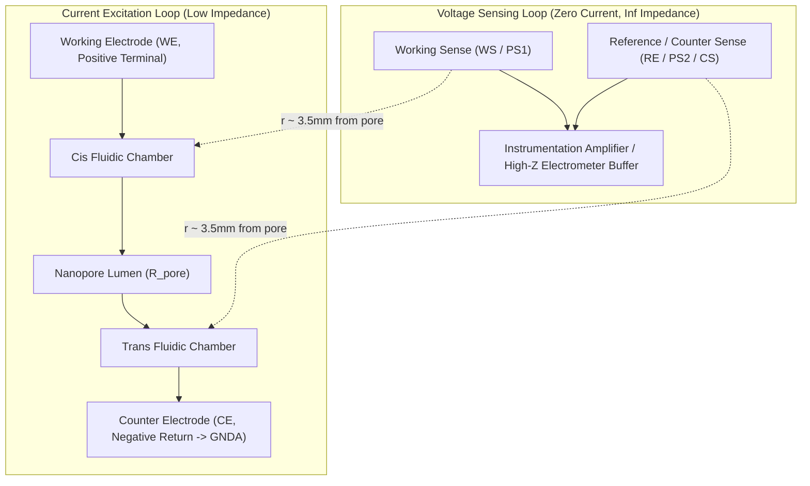
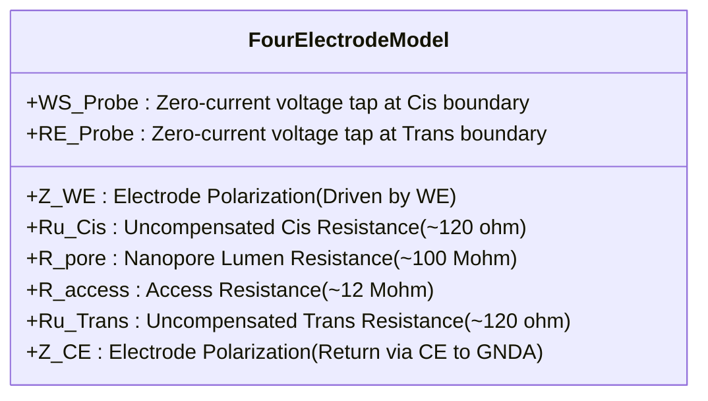

# Interposer Four-Electrode Electrochemical Cell Architecture

**Document Version:** 1.0.0  
**References:**
- ACS Journal of Physical Chemistry C: *"Method of the Four-Electrode Electrochemical Cell"* (J. Phys. Chem. C 2017, 121, 8, 4112–4119) [DOI: 10.1021/acs.jpcc.6b12543]
- Gamry Instruments: *"Two-, Three-, and Four-Electrode Experiments"* (Application Note)
- Target Substrate: 0.8 mm Rogers RO4350B / PTFE ($\epsilon_r = 2.1$, $\tan\delta = 0.0002$, ENIG Finish)

---

## 1. Executive Summary & Problem Definition

In solid-state and biological nanopore sensing, the ionic current flowing through a nanoscale lumen ($1 - 100\text{ nA}$ at $100 - 200\text{ mV}$) is measured to detect single-molecule translocations.

### The Limitation of Traditional 2-Electrode Cells with "Off-to-the-Side" Electrodes
In traditional nanopore readers, two Ag/AgCl electrodes are placed in remote fluidic reservoirs or access ports ("off to the side", $15 - 25\text{ mm}$ away from the aperture):

```
[Remote Cis Electrode] ──(Long Channel: Ru)──> [Nanopore Aperture] ──(Long Channel: Ru)──> [Remote Trans Electrode]
```

This arrangement introduces two major measurement bottlenecks:
1. **Electrode Polarization & Interfacial Impedance ($Z_{int}$)**:
   Because the same electrodes apply current and measure voltage, the electrode-electrolyte interface impedance (charge-transfer resistance $R_{ct}$, Warburg diffusion impedance $Z_w$, and double-layer capacitance $C_{dl}$) appears **in series with the nanopore**:
   $$V_{measured} = I_{pore} \cdot \left( R_{pore} + R_{access} + 2 R_u + 2 Z_{int}(\omega) \right)$$
   Under continuous DC voltage bias, Ag/AgCl ribbons undergo surface polarization and chloride depletion, causing severe baseline drift. At high frequencies ($> 10\text{ kHz}$), $C_{dl}$ introduces phase lag and attenuates fast translocation spikes.
2. **Uncompensated Solution Resistance ($R_u$)**:
   The long microfluidic channels between the remote electrodes and the chip pocket introduce several kilo-ohms of uncompensated electrolyte resistance ($R_u \approx 1.5 - 3.0\text{ k}\Omega$). When combined with membrane and flowcell capacitance ($C_m \approx 50 - 150\text{ pF}$), $R_u$ forms an unwanted low-pass $RC$ filter:
   $$f_c = \frac{1}{2 \pi R_u C_m} \approx 500\text{ kHz} - 1\text{ MHz}$$
   This degrades transient edge response and distorts sub-microsecond translocation dwell times.

---

## 2. The Four-Electrode Electrochemical Cell Solution

By migrating to a **Kelvin Four-Electrode Configuration** arranged in a **tight concentric/coaxial geometry** directly flanking the nanopore wafer pocket, the current delivery is physically decoupled from potential sensing.



### Standardized Electrochemical Terminology (Gamry Standards)

| Terminal | Standard Symbol | Physical Role in Daemon Pore | Potential / Connection |
| :--- | :--- | :--- | :--- |
| **Working Electrode** | **`WE`** | Current delivery electrode in Cis chamber. Forces electrophoretic flux toward pore. | **Positive Terminal ($+V_{bias}$)** |
| **Working Sense** | **`WS` / `PS1`** | High-impedance potential sensing probe located in Cis electrolyte immediately adjacent to the pore. | Non-inverting electrometer buffer ($I_{sense} \approx 0\text{ fA}$) |
| **Reference Electrode** | **`RE` / `PS2`** | Potential sensing probe located in Trans electrolyte immediately adjacent to the pore. | Inverting electrometer buffer / Reference probe |
| **Counter Electrode** | **`CE`** | Current return electrode in Trans chamber. Collects total pore current. | **Analog Ground (`GNDA` / Virtual Ground)** |
| **Counter Sense** | **`CS`** | Senses potential directly at the Counter Electrode to eliminate lead/contact resistance. | Kelvin sense return to control loop |
| **Floating Ground** | **`FloatGND` / `GNDA`** | The complete analog reference plane of the cell is isolated from mains Earth and digital USB GND. | Decoupled analog ground (low noise) |

---

## 3. Channel-Aligned Ag/AgCl Ribbon Architecture

### Why Planar Concentric Rings Fail
A superficial implementation of concentric rings on an open PCB surface encounters severe fundamental failures:
1. **Liquid Shorting**: Bulk electrolyte in a single chamber directly bridges and shorts open concentric rings together.
2. **Polarization & Non-Reversibility**: Bare ENIG gold traces exposed to 1M KCl undergo irreversible charge transfer and water oxidation; true **silver chloride ($\text{Ag/AgCl}$)** interfaces are mandatory for stable, low-noise non-polarizable electrochemistry.
3. **Mechanical Collisions**: $360^\circ$ annular rings cut across the silicone gasket sealing boundaries and intersect the dowel alignment pin holes (`H1` NPTH) at $r=7.0\text{ mm}$.
4. **Routing Traps**: On a 2-layer board, an unbroken outer annular ring prevents planar traces from reaching the inner sense ring without shorting.

### The Solution: 4 Channel-Aligned Microfluidic Ag/AgCl Ribbons
The 4-electrode Kelvin cell is implemented using **dual channel-aligned Ag/AgCl ribbon electrode pockets (`J10`, `J11`, `J1`, `J2`)** recessed along the linear $1.4\text{ mm}$ wide microfluidic channels clamped by the cast silicone gasket:

```
TOP LAYER (Cis Inlet Channel, 30° / F.Cu):
[Fluid In] ──> [J10: WE_POS (r=15.8mm)] ──> [J11: WS_CIS (r=6.9mm)] ──> [Nanopore Wafer Pocket: H1]
               • Positive Current Drive      • High-Z Voltage Sense Tap

BOTTOM LAYER (Trans Outlet Channel, 210° / B.Cu):
[Nanopore Wafer Pocket: H1] ──> [J1: RE_TRANS (r=6.85mm)] ──> [J2: CE_GNDA (r=15.8mm)] ──> [Fluid Out]
                                • High-Z Reference Sense Tap  • Negative Current Return (GNDA)
```

### Physical Implementation Details:
1. **Electrode Material**: Pre-chloridized silver ribbons ($2.0\text{ mm} \times 0.8\text{ mm} \times 0.1\text{ mm}$, Alfa Aesar 99.9% Ag foil treated in $0.1\text{ M FeCl}_3$) seated into PCB solder mask recesses.
2. **Hermetic Confinement**: The cast silicone gaskets (`Cast_Nanopore_Wafer_Gasket` and `Fitted_Amplifier_Gasket`) press directly against the PTFE interposer, confining electrolyte strictly to the $1.4\text{ mm}$ channel and preventing cross-electrode liquid shorting.
3. **Proximity Optimization**:
   - `WS_CIS` (`J11`) and `RE_TRANS` (`J1`) are positioned immediately adjacent to the $4\times 4\text{ mm}$ silicon wafer aperture ($r \approx 6.85 - 6.90\text{ mm}$), tapping the transmembrane potential boundary with near-zero uncompensated solution drop ($< 150\,\Omega$).
   - `WE_POS` (`J10`) and `CE_GNDA` (`J2`) are placed upstream and downstream ($r \approx 15.8\text{ mm}$), isolating current-injection polarization ($Z_{WE}, Z_{CE}$) from the sensing electrometers.
4. **Zero Trace Crossings**:
   - Cis signals (`WE_POS`, `WS_CIS`) route exclusively on Top Layer (`F.Cu`).
   - Trans signals (`CE_GNDA`, `RE_TRANS`) route exclusively on Bottom Layer (`B.Cu`).
   - No vias cut between Cis and Trans, providing infinite DC isolation and zero capacitive cross-talk.

---

## 4. Equivalent Circuit Model & Transfer Function



### Circuit Mathematical Formulation:
- Let $I$ be the applied electrophoretic current:
  $$I = \frac{V_{WE} - V_{CE}}{Z_{WE} + R_{u,cis} + R_{pore} + 2 R_{access} + R_{u,trans} + Z_{CE}}$$
- The potential sensed between `WS` and `RE` is:
  $$V_{WS} - V_{RE} = I \cdot \left( R_{pore} + 2 R_{access} \right) + I_{sense} \cdot Z_{sense}$$
- Since the electrometer buffer input impedance $R_{buffer} \ge 10^{13}\,\Omega$:
  $$I_{sense} \approx 0 \implies V_{WS} - V_{RE} \equiv I \cdot \left( R_{pore} + 2 R_{access} \right)$$
- **Result:**
  1. $Z_{WE}$ and $Z_{CE}$ (electrode interfacial capacitance and polarization) are **completely eliminated** from the measured potential.
  2. $R_u$ is reduced from remote values to $< 150\,\Omega$.
  3. The transimpedance amplifier measures the **pure transmembrane ionic current with zero drift**.

---

## 5. 6-Pin Pogo Interface Pinout Mapping

To mate with the Mill-Max spring pin array header on the Amplifier board, the Interposer's 6 gold target pads (`J_POGO1`, rotated $180^\circ$ at $Y=73.5\text{ mm}$) map symmetrically to the Cis and Trans channels:

| Pin # | Board X | Net Name | Electrochemical Function (Gamry Standard) | Connection |
| :---: | :---: | :--- | :--- | :--- |
| **1** | $176.0\text{ mm}$ | `CE_GNDA` | **Counter Electrode (`CE`)** | Negative current return connected to `GNDA` (`J2` Trans outer ribbon) |
| **2** | $171.0\text{ mm}$ | `RE_TRANS` | **Reference Electrode (`RE` / `CS`)** | High-Z potential sensing probe at Trans pore boundary (`J1`) |
| **3** | $166.0\text{ mm}$ | `GNDA` | **Floating Analog Ground (`FloatGND`)** | Decoupled analog ground reference and driven guard |
| **4** | $163.0\text{ mm}$ | `WEEP_SENSE` | **Weep Moat Perimeter Leak Detector** | Moisture detection loop with hardware emergency stop cutoff |
| **5** | $158.0\text{ mm}$ | `WS_CIS` | **Working Sense (`WS` / `PS1`)** | High-Z potential sensing probe at Cis pore boundary (`J11`) |
| **6** | $153.0\text{ mm}$ | `WE_POS` | **Working Electrode (`WE`)** | Positive terminal ($+V_{bias}$ current drive to `J10` Cis outer ribbon) |

---

## 6. Driven Guard, Weep Sense Moat, and Full-Board GNDA Ground Flood

### Can Guard and Weep Sense Be Used as One and the Same?
**No. They serve diametrically opposed electrical functions and must remain electrically separate nets:**
1. **Driven Guard (`GUARD` / Pad 2)**:
   - **Operating Principle**: Active, low-impedance op-amp output driven at $V_{guard} \approx V_{sense}$ ($\Delta V = 0$) to eliminate picoampere dielectric surface leakage into the ultra-high impedance electrometer nodes (`WS_CIS`, `RE_TRANS`).
   - **Why it cannot be Weep Sense**: If shorted to leaked conductive fluid (1M KCl), the low-Z buffer would supply heavy current directly into the leak, corrupting the biological measurement, overloading the buffer, and masking the impedance collapse needed for leak detection.
2. **Weep Sense (`WEEP_SENSE` / Pad 4)**:
   - **Operating Principle**: Passive, high-impedance sensing input biased through a weak pull-up (e.g. $1\,\text{M}\Omega$ to $3.3\,\text{V}$) into an analog comparator / ADC threshold.
   - **Detection Action**: In dry operation, the open air gap between the `WEEP_SENSE` trace and the adjacent `GNDA` copper flood exhibits $> 10\,\text{G}\Omega$ isolation. When any conductive saline breaches the silicone gasket seal, it bridges across the narrow $0.25\,\text{mm}$ gap to `GNDA`, collapsing the net impedance to $< 1\,\text{k}\Omega$ and tripping an immediate hardware ESTOP / pump shutdown.

### Concentric Guard-and-Moat Layout Hierarchy
To achieve both picoampere femtofarad signal integrity and hermetic leak security, the interposer layout implements a concentric hierarchy:
```
[Sensing Node (WS_CIS / RE_TRANS Pad 1)]
       │
       ▼ (Inside gasket boundary)
[Driven Guard Ring (Pad 2, Delta V = 0, Low-Z)]
       │
       ▼ (Mechanical compression interface)
[Cast Silicone Gasket Hermetic Seal Rib]
       │
       ▼ (Outside gasket boundary)
[Weep Sense Moat Trace (WEEP_SENSE, High-Z passive)]
       │
       ▼ (0.25 mm uniform detection spark gap)
[GNDA Full-Board Copper Pour (F.Cu & B.Cu Flood)]
```

### Channel-Contouring Geometry
- **Top Layer (`F.Cu`)**: The `WEEP_SENSE` trace flanks both sides of the Cis microfluidic channel ($210^\circ \leftrightarrow \text{Center} \leftrightarrow 30^\circ$) at a $2.8\,\text{mm}$ offset, wrapping around the central aperture keepout and both fluid ports.
- **Bottom Layer (`B.Cu`)**: The `WEEP_SENSE` trace flanks both sides of the Trans microfluidic channel ($150^\circ \leftrightarrow \text{Center} \leftrightarrow 330^\circ$) at a $2.8\,\text{mm}$ offset.
- **Inter-Layer Stitching**: Top and bottom moat traces are bonded into a single continuous dual-sided leak detection fence via stitch vias at $(163.0, 68.0)$, $(180.4, 46.1)$, and $(148.6, 70.9)$.
- **GNDA Copper Pour**: Both `F.Cu` and `B.Cu` outer copper layers are flooded with `GNDA` across the entire hexagonal interposer envelope, maintaining an exact $0.25\,\text{mm}$ detection gap to `WEEP_SENSE` over its complete perimeter.

### Hardware Interlock & Negative Excursion Protection (ECO-2026-004)
On the Amplifier / MR1 board, the `WEEP_SENSE` pogo line (Pin 4) directly controls the enable pin of the **LP5907 1.8V LDO (`U11`)** that powers the AD40xx high-speed ADC. 

Because `PORE_amp` delivers bidirectional excitation up to $\pm 2.5\text{ V}$, any direct unbuffered connection would expose the LP5907 EN pin (Absolute Maximum Rating: $-0.3\text{ V}$ to $V_{IN} + 0.3\text{ V}$) to destructive negative excursions.

An active **N-channel MOSFET buffer (2N7002 / BSS138) with Schottky clamping** is placed at the input:
- **$R_{limit} = 100\text{ k}\Omega$**: Limits injected fault current to $\le 22\text{ }\mu\text{A}$.
- **$D_1$ (BAT54)**: Clamps negative excursion at the gate to $-0.3\text{ V}$ (Cathode to Gate, Anode to `GNDA`).
- **$R_{gate} = 1\text{ M}\Omega$**: Bleeder pull-down keeping the N-FET OFF in dry quiescent operation.
- **$R_{pullup} = 100\text{ k}\Omega$**: Pulls U11 EN to $+3.3\text{ V}$ dry.
- **Trigger Action**: A positive excursion or 1M KCl saline breach ($+2.5\text{ V}$) raises the Gate to $+2.27\text{ V} > V_{GS(th)}$, turning the N-FET ON, clamping U11 Pin 3 to `GNDA`, instantly collapsing the 1.8V analog rail to $0\text{ V}$, and halting ADC conversions.

See `docs/ECO_WEEP_SENSE_BUFFER_INTERLOCK.md` for complete rework directives and verification procedures.

---

## 7. Manufacturing & Cleaning Specifications

1. **Substrate Material**: Rogers RO4350B or pure PTFE laminate ($0.8\text{ mm}$ thickness, $\epsilon_r = 2.1$, surface resistivity $> 10^{14}\,\Omega/\Box$).
2. **Plating**: Electroless Nickel Immersion Gold (**ENIG**), minimum $50\,\mu\text{in}$ soft gold over $150\,\mu\text{in}$ nickel to resist 1M KCl chlorination and corrosion.
3. **Solder Mask**: Top and bottom annular rings and diamond pocket must be **free of solder mask** (mask-defined or metal-defined with $0.1\text{ mm}$ expansion) to prevent polymer outgassing and bio-fouling.
4. **Plasma / Solvent Cleaning**: Prior to chip insertion, interposer must undergo:
   - 10 min sonication in HPLC-grade isopropanol.
   - 10 min sonication in $18.2\text{ M}\Omega\cdot\text{cm}$ Milli-Q water.
   - 3 min air/oxygen plasma etching at $30\text{ W}$ to render the PTFE and gold surfaces hydrophilically active for bubble-free priming.
