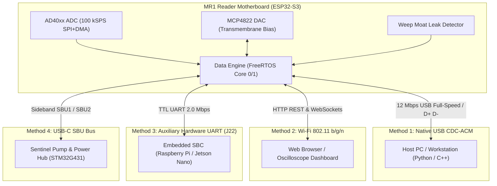

# MR1 Nanopore Reader — Universal Data Exchange & Interfacing Specification

**Document Version:** 1.0.0  
**Target Hardware:** MR1 Digital Motherboard (ESP32-S3 @ 240 MHz, AD40xx 16/18-bit ADC, MCP4822 Dual DAC)  
**Co-Processors & Subsystems:** Sentinel Pump Controller (STM32G431), Host DAQ Client (`src/daq_client.py`), Web Portal, and External Single-Board Computers (Raspberry Pi, NVIDIA Jetson).

---

## 1. System Interfacing Topology

The MR1 Nanopore Reader provides four independent physical and transport communication channels for commands, telemetry, and continuous high-speed data streaming:



---

## 2. Interface Comparison Matrix

| Interface Method | Physical Medium | Data Rate / Baud | Primary Use Case | Protocol / Framing |
| :--- | :--- | :--- | :--- | :--- |
| **Method 1: USB CDC-ACM** | USB-C (`GPIO19/20`) | 12 Mbps Full-Speed | High-throughput 100 kSPS raw data streaming & PC CLI | Dual-mode: Binary `SENT` framing + ASCII CLI |
| **Method 2: Wi-Fi HTTP / WS** | 2.4 GHz 802.11 b/g/n | ~54 Mbps PHY | Cable-free browser oscilloscope, configuration, updates | JSON REST API + Binary WebSocket stream |
| **Method 3: Hardware UART** | 4-Pin JST (`GPIO17/47`) | 115,200 to 2,000,000 baud | Embedded SBC integration (Jetson, Raspberry Pi) | Compact binary `SENT` or Packet framing with CRC |
| **Method 4: USB-C SBU Link** | SBU1/SBU2 pins | 100 kHz I2C or 115.2k UART | Synchronized fluidics, pressure alarms & power cutoff | Packet framing (`0xAA` SOF, 8-bit XOR checksum) |

---

## 3. Method 1: Native USB CDC-ACM (Primary Workstation Link)

Operating via the ESP32-S3 native USB-OTG peripheral, this interface operates in **dual-mode**:
- **ASCII Command Console** for human and scripting control.
- **Binary High-Speed Stream** for continuous, low-latency 100 kSPS acquisition.

### 3.1 Binary Stream Packet Format (`StreamFrame`)
Binary packets are emitted continuously when acquisition is active. Packets use fixed Little-Endian alignment with a 16-bit CRC-16-CCITT tail.

#### 64-Sample Stream Frame Layout (146 Bytes Total):
```
 0                   1                   2                   3
 0 1 2 3 4 5 6 7 8 9 0 1 2 3 4 5 6 7 8 9 0 1 2 3 4 5 6 7 8 9 0 1
+-+-+-+-+-+-+-+-+-+-+-+-+-+-+-+-+-+-+-+-+-+-+-+-+-+-+-+-+-+-+-+-+
|                      magic: 'S' 'E' 'N' 'T'                   | (0x53454E54)
+-+-+-+-+-+-+-+-+-+-+-+-+-+-+-+-+-+-+-+-+-+-+-+-+-+-+-+-+-+-+-+-+
|                         frame_index                           | (uint32)
+-+-+-+-+-+-+-+-+-+-+-+-+-+-+-+-+-+-+-+-+-+-+-+-+-+-+-+-+-+-+-+-+
|                        timestamp_us                           | (uint32)
+-+-+-+-+-+-+-+-+-+-+-+-+-+-+-+-+-+-+-+-+-+-+-+-+-+-+-+-+-+-+-+-+
|         sample_count          |         status_flags          | (uint16, uint16)
+-+-+-+-+-+-+-+-+-+-+-+-+-+-+-+-+-+-+-+-+-+-+-+-+-+-+-+-+-+-+-+-+
|          sample[0]            |          sample[1]            | (int16 signed)
+-+-+-+-+-+-+-+-+-+-+-+-+-+-+-+-+-+-+-+-+-+-+-+-+-+-+-+-+-+-+-+-+
|                             ...                               |
+-+-+-+-+-+-+-+-+-+-+-+-+-+-+-+-+-+-+-+-+-+-+-+-+-+-+-+-+-+-+-+-+
|          sample[62]           |          sample[63]           | (int16 signed)
+-+-+-+-+-+-+-+-+-+-+-+-+-+-+-+-+-+-+-+-+-+-+-+-+-+-+-+-+-+-+-+-+
|             crc16             | (uint16 CCITT)
+-+-+-+-+-+-+-+-+-+-+-+-+-+-+-+-+
```

#### Field Specifications:
| Offset | Field | Type | Description |
| :--- | :--- | :--- | :--- |
| `0..3` | `magic` | `uint32` | Constant sync word: `0x53454E54` (`"SENT"` in ASCII) |
| `4..7` | `frame_index` | `uint32` | Monotonically incrementing 32-bit counter (detects dropped packets) |
| `8..11` | `timestamp_us` | `uint32` | Microsecond clock at acquisition of the first sample in this frame |
| `12..13`| `sample_count` | `uint16` | Number of current samples in payload (Nominal: 64) |
| `14..15`| `status_flags` | `uint16` | Hardware bitmask (see table below) |
| `16..143`| `samples[64]` | `int16[64]` | 64 signed differential ADC codes ($\pm 32768 = \pm 2.048\text{ V}$) |
| `144..145`| `crc16` | `uint16` | CRC-16-CCITT (poly `0x1021`, init `0xFFFF`) over bytes `0..143` |

#### `status_flags` Bitmask Definition:
- **Bit 0 (`0x0001`)**: `ACQUISITION_ACTIVE` — Continuous streaming enabled.
- **Bit 1 (`0x0002`)**: `TIA_SATURATED` — TIA output clamped to power rails ($> \pm 2\text{ nA}$).
- **Bit 2 (`0x0004`)**: `LEAK_DETECTED` — Weep moat impedance drop triggered (emergency alert).
- **Bit 3 (`0x0008`)**: `PUMP_OCCLUSION` — Pump feedline backpressure exceeded limit ($> 10\text{ psi}$).
- **Bit 4 (`0x0010`)**: `PUMP_CONNECTED` — Active SBU link to pump controller verified.
- **Bit 5 (`0x0020`)**: `BUFFER_OVERRUN` — DMA buffer was delayed by host USB polling.

### 3.2 Physical Current Conversion Formula
To calculate physical current $I_{pore}$ from ADC signed 16-bit integer $S_{adc}$:

$$V_{adc} = S_{adc} \cdot \left(\frac{2.048\text{ V}}{32768}\right) = S_{adc} \cdot 62.5\,\mu\text{V}$$

$$I_{pore} = \frac{V_{adc}}{R_{feedback}} = \frac{S_{adc} \cdot 62.5 \times 10^{-6}\text{ V}}{1.0 \times 10^9\,\Omega} = S_{adc} \cdot \mathbf{62.5\text{ fA}}$$

- **Dynamic Range:** $-2.048\text{ nA}$ to $+2.048\text{ nA}$ (for $1\text{ G}\Omega$ TIA feedback resistor).

---

## 4. ASCII & Scripting Command Dictionary

Commands are sent as human-readable ASCII lines terminated by `\n` or `\r\n`. Every valid command receives an affirmative `OK\n` or an error response `ERR:<code_or_reason>\n`.

| Command | Arguments | Example | Description |
| :--- | :--- | :--- | :--- |
| `START` | None | `START\n` | Starts 100 kSPS binary stream output. |
| `STOP` | None | `STOP\n` | Halts binary stream output and returns to idle console mode. |
| `SET:BIAS` | `<mv>` ($\pm 1587$) | `SET:BIAS 180.0\n` | Sets transmembrane voltage bias via MCP4822 DAC. |
| `GET:BIAS` | None | `GET:BIAS\n` | Returns currently applied bias in millivolts (`BIAS:180.0\n`). |
| `STATUS` | None | `STATUS\n` | Returns JSON status dictionary containing voltages, leak, and pump state. |
| `ESTOP` | None | `ESTOP\n` | Immediate hardware safety shutdown: zeroes bias DAC, cuts motor power. |
| `PUMP:SET` | `<id> <rate>` | `PUMP:SET 1 25.0\n` | Sets Pump 1 (Cis) flow rate to $25.0\,\mu\text{L/min}$. |
| `PUMP:STOP` | None | `PUMP:STOP\n` | Commands fluidic pumps to halt normally. |
| `CAL:TARE` | None | `CAL:TARE\n` | Auto-zeros the baseline ADC reading with zero applied bias. |
| `VERSION` | None | `VERSION\n` | Returns firmware, board revision, and serial number. |

---

## 5. Method 2: Wi-Fi Web Portal & WebSockets

When enabled, MR1 starts a local softAP (`MR1-Nanopore-XXXX`) or joins an existing laboratory Wi-Fi network with mDNS discovery (`http://mr1-nanopore.local`).

### 5.1 HTTP REST Endpoints
- **`GET /api/status`**: Returns high-level telemetry JSON:
  ```json
  {
    "device": "MR1 Nanopore Reader",
    "firmware": "1.0.0",
    "uptime_s": 1420,
    "bias_mv": 180.0,
    "mean_current_pa": 1245.8,
    "rms_noise_pa": 1.15,
    "leak_detected": false,
    "cis_pressure_psi": 2.45,
    "trans_pressure_psi": 0.82,
    "streaming": true
  }
  ```
- **`POST /api/bias`**: Payload `{"bias_mv": 200.0}` sets transmembrane bias voltage.
- **`POST /api/pump`**: Payload `{"pump": 1, "rate_ul_min": 15.0, "dir": "FWD"}` controls fluidics.
- **`POST /api/estop`**: Payload `{}` triggers emergency stop.

### 5.2 WebSocket Streaming (`ws://localhost:8765/stream`)
- **Binary Channel**: Streams decimated 1,000-sample blocks ($10\text{ kSPS}$ downsampled from $100\text{ kSPS}$) formatted as single-precision 32-bit IEEE floats for live browser plotting.
- **JSON Telemetry Channel**: Emits periodic health status frames at 10 Hz.

---

## 6. Method 3: Auxiliary Hardware UART (Expansion Header J22)

Designed for headless embedded operation on single-board computers (Raspberry Pi, NVIDIA Jetson, Coral Dev Board):
- **Physical Pins:** `PIN_PUMP_TX` (`GPIO47`), `PIN_PUMP_RX` (`GPIO17`), `GND`, `+3V3`.
- **Baud Rates:** Configurable for $115{,}200$ (default debugging) up to $2{,}000{,}000$ baud (full binary streaming payload).
- **Format:** 8 data bits, no parity, 1 stop bit (`8N1`), no flow control.
- **Payload:** Accepts identical command structure and outputs standard `StreamFrame` binary packets as Method 1.

---

## 7. Method 4: USB-C SBU (Sideband Use) Inter-Board Link

Communicates across the USB-C cable with the Sentinel Pump Controller:
- **Auto-Polarity Detection:** SBU manager tests orientation on plug insertion to map SBU1/SBU2 to SCL/SDA or TX/RX regardless of cable orientation.
- **Packet Structure (Compact 5-Byte Framing):**

| Byte | Field | Description |
| :--- | :--- | :--- |
| `0` | `0xAA` | Start-of-Frame sync byte |
| `1` | `cmd` | Command ID (`0x01`=Run, `0x02`=Stop, `0x03`=ESTOP, `0x11`=Pressure Report) |
| `2` | `param_lsb` | Parameter lower byte (RPM or centi-psi) |
| `3` | `param_msb` | Parameter upper byte |
| `4` | `checksum` | XOR checksum: `0xAA ^ cmd ^ param_lsb ^ param_msb` |

---

## 8. Downstream File Storage Formats

For downstream recording, archiving, and analysis, the Host DAQ bridge (`src/daq_client.py`) formats recordings into the following formats:

### 8.1 Hierarchical Data Format (HDF5 / `.h5`)
Optimized for multi-hour recordings at 100 kSPS ($720\text{ MB/hour}$ uncompressed, $\sim 280\text{ MB/hour}$ with Blosc/zlib compression):

```
sentinel_experiment_20261001_143000.h5
├── /acquisition
│   ├── current_pa           [Dataset: (N,) float32, chunked=(65536,)]
│   ├── timestamps_us        [Dataset: (N,) uint64]
│   └── status_flags         [Dataset: (N,) uint16]
├── /events
│   ├── event_id             [Dataset: (M,) uint32]
│   ├── start_time_us        [Dataset: (M,) uint64]
│   ├── duration_us          [Dataset: (M,) float32]
│   ├── baseline_current_pa  [Dataset: (M,) float32]
│   ├── blockade_depth_pa    [Dataset: (M,) float32]
│   └── fractional_blockade  [Dataset: (M,) float32]
└── /metadata (Attributes)
    ├── experimenter: "Loki-VR"
    ├── sample_rate_hz: 100000
    ├── bias_voltage_mv: 180.0
    ├── pore_type: "SiNx solid-state (4.0nm)"
    ├── buffer: "1.0M KCl, 10mM Tris, pH 8.0"
    └── t_amplifier_gain_ohms: 1.0e9
```

### 8.2 Streaming CSV (`.csv`)
For quick verification in pandas, Excel, or MATLAB:
```csv
timestamp_us,current_pa,bias_mv,cis_pressure_psi,status_flags
5400200,1248.5,180.0,2.45,1
5400210,1249.1,180.0,2.45,1
5400220,1247.9,180.0,2.45,1
```

---

## 9. Implementation Examples

### Python Reader Example (PySerial + Struct Unpacking)
```python
import serial
import struct

STREAM_MAGIC = 0x53454E54 # 'SENT'

def listen_nanopore(port="COM3", baud=2000000):
    with serial.Serial(port, baud, timeout=1.0) as ser:
        ser.write(b"START\n")
        
        while True:
            # Sync to magic word 'SENT'
            header = ser.read(4)
            if header != b"SENT":
                continue
                
            payload = ser.read(142) # Remaining 142 bytes of StreamFrame
            full_frame = header + payload
            
            magic, idx, ts_us, count, flags = struct.unpack_from("<IIHH", full_frame, 0)
            samples = struct.unpack_from(f"<{count}h", full_frame, 16)
            
            # Convert first sample to picoamperes (62.5 fA/count = 0.0625 pA/count)
            current_pa = samples[0] * 0.0625
            print(f"[Frame {idx:06d} @ {ts_us} us] Current: {current_pa:.2f} pA | Flags: 0x{flags:04X}")

if __name__ == "__main__":
    listen_nanopore()
```
