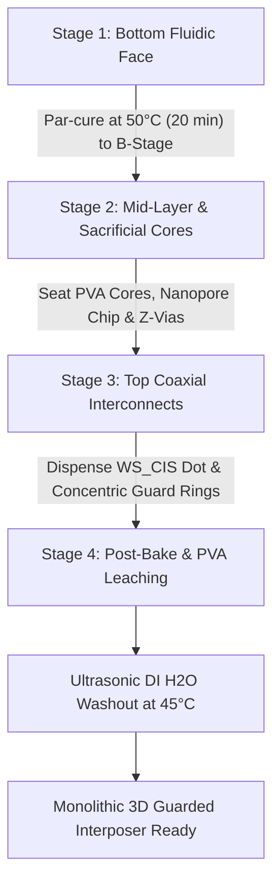

# Multi-Stage Concentric Casting Specification: 3D Driven Guard Interposer

**Project:** MR1 Nanopore Reader / Electrochemical Front-End  
**Module:** Concentric 3D-Guarded Elastomeric Interposer & Fluidic Molds  
**Author:** Lawrence R. Kincheloe III / Molecular Reality Corp (2026)  
**License:** CC0 1.0 Universal (CC0-1.0) / Public Domain  

---

## 1. Executive Summary & Physics of In-Situ 3D Guarding

Ultra-sensitive nanopore measurements require resolving sub-picoampere ($< 1\text{ pA}$) to low-nanoampere ionic translocation currents at bandwidths up to $100\text{ kHz}$. In planar PCB routing, driven guards (bootstrapped shields matching the sensing node potential, $\Delta V = 0$) mitigate surface and dielectric leakage currents on the board. However, when bridging the physical boundary between the active amplifier PCB and the microfluidic flow cell, conventional mechanical connectors (such as pogo pins or elastomer strips) suffer from stray capacitive crosstalk, surface condensation leakage, and mechanical stress concentrations.

**Multi-stage casting** directly solves this challenge by casting **3D driven guard coaxial structures into a monolithic elastomeric interposer**:
* A central conductive silicone dot carries the ultra-high impedance signal (`WS_CIS`).
* An insulating dielectric gap surrounds the dot ($R_{\text{volume}} > 10^{15}\,\Omega\cdot\text{cm}$).
* An annular conductive silicone ring surrounds the gap, driven actively by the electrometer op-amp guard buffer (`GUARD`, $\Delta V \approx 0$).
* An outer concentric conductive ring acts as a Faraday shield tied to analog ground (`GNDA`).

Because platinum-cure addition silicones chemically cross-link across cure stages, multi-stage casting produces a **completely seamless, monolithic component** with zero internal mechanical interfaces or capillary leakage paths.

```
                  Top Interface: Amplifier PCB (0.8 mm PTFE / ENIG)
       [ GNDA Faraday ]  (Gap)  [ Driven GUARD ]  (Gap)  [ Core WS_CIS Dot ]  (Gap)  [ Driven GUARD ]  (Gap)  [ GNDA Faraday ]
   =========================================================================================================================
   |                                      Top Monolithic Insulating Silicone Matrix                                        |
   -------------------------------------------------------------------------------------------------------------------------
   |                              Sacrificial PVA Microfluidic Channels + Nanopore Chip                                    |
   -------------------------------------------------------------------------------------------------------------------------
   |                                     Bottom Monolithic Insulating Silicone Matrix                                      |
   =========================================================================================================================
       [ Ag/AgCl CE Ring ]     (Crush-Rib Seal)     [ Central Aperture ]     (Crush-Rib Seal)     [ Ag/AgCl RE Ring ]
                 Bottom Interface: Polypropylene (PP) Fluidic Baseplate (Compression Gasket)
```

---

## 2. Chemical Architecture & Interfacial Cross-Linking

### 2.1 Base Elastomer Formulation
* **Polymer Base:** 2-part addition-cure (platinum-catalyzed) polydimethylsiloxane (PDMS), e.g., Smooth-On Sorta-Clear 37 / 40 or Dow Corning Sylgard 184.
* **Stoichiometry:** 10:1 (Base : Curing Agent by weight).
* **Dielectric Properties:**
  * Dielectric Strength: $> 20\text{ kV/mm}$ ($500\text{ V/mil}$).
  * Volume Resistivity: $> 1.0 \times 10^{15}\,\Omega\cdot\text{cm}$.
  * Dielectric Constant ($\epsilon_r$): $2.75$ at $100\text{ kHz}$.
  * Hardness: $40\text{ Shore A}$ (optimum balance between compliance and dimensional stability).

### 2.2 Conductive Elastomer Formulation
* **Conductive Filler:** Silver-coated copper flakes ($10\text{–}25\,\mu\text{m}$, $> 15\text{ wt}\%$ Ag coating) or pure silver nanoparticles blended into the Sorta-Clear 40 base.
* **Loading Fraction:** $28.0\text{ wt}\%$ (above percolation threshold).
* **Conductivity Targets:**
  * Bulk Resistivity ($\rho$): $< 0.1\,\Omega\cdot\text{cm}$.
  * Contact Resistance: $< 0.2\,\Omega$ per contact dot at $15\%$ compression strain.
  * Elastic Modulus: $E \approx 2.5\text{ MPa}$ ($50\text{ Shore A}$).

### 2.3 Interfacial Covalent Cross-Linking (Zero-Seam Boundary)
To achieve a monolithic part without delamination or microscopic voids:
1. Stage $N$ is cured only to the **"B-stage" / green gel state** (approx. $70\text{–}80\%$ hydride conversion, $45^\circ\text{C}$ for $20\text{ minutes}$).
2. Stage $N+1$ liquid silicone is dispensed directly against the gelled surface.
3. Residual vinyl ($\text{--CH=CH}_2$) and hydrosilyl ($\text{--Si--H}$) groups cross-polymerize across the interface during the final full cure ($70^\circ\text{C}$ for 2 hours).
4. The resulting boundary has no optical seam, no contact impedance, and identical tear strength to bulk silicone ($> 20\text{ kN/m}$).

---

## 3. Four-Stage Manufacturing Workflow



### Stage 1: Bottom Fluidic Interface & Ag/AgCl Ring Contacts
1. **Tooling:** CNC Delrin/Resin bottom mold plate with annular ring grooves and perimeter sealing contours.
2. **Conductive Cast:**
   * Dispense conductive silicone into the annular electrode ring cavities:
     * Inner ring ($\varnothing 10.8\text{ mm}$ mean): Reference Electrode (`RE_TRANS`).
     * Outer ring ($\varnothing 15.4\text{ mm}$ mean): Counter Electrode (`CE_GNDA`).
   * Degas under vacuum ($< 10\text{ mbar}$, 5 min).
   * Par-cure at $50^\circ\text{C}$ for 20 minutes (B-stage gel).
3. **Insulating Gasket Field & Sealing Crush-Ribs:**
   * Pour clear insulating PDMS over the base mold plate.
   * The mold plate includes semi-circular annular recesses ($0.4\text{ mm}$ depth, $0.8\text{ mm}$ width) around all 4 fluid ports (`P_CIS_IN`, `P_CIS_OUT`, `P_TRANS_IN`, `P_TRANS_OUT`), casting proud **compliant crush-rib O-ring beads** on the bottom surface.
   * Par-cure at $50^\circ\text{C}$ for 20 minutes.

### Stage 2: Mid-Layer Sacrificial Fluidic Cores & Nanopore Seating
1. **Sacrificial PVA Fluidic Cores:**
   * Insert water-soluble 3D-printed PVA (Polyvinyl Alcohol) microfluidic channel cores ($500\,\mu\text{m} \times 300\,\mu\text{m}$) into precision registration sockets in the mold.
2. **Nanopore Chip Seating:**
   * Place the $4.0 \times 4.0\text{ mm}$ silicon/SiN nanopore chip over the central alignment boss.
3. **Vertical Z-Axis Conductive Interconnect Pillars:**
   * Dispense vertical conductive pillars connecting the bottom electrode rings to the upper interconnect routing.
4. **Mid-Body Insulating Encapsulation:**
   * Fill the mid-layer with insulating PDMS, fully potting the chip perimeter and channel cores.
   * Degas under vacuum to eliminate micro-bubbles.
   * Par-cure at $50^\circ\text{C}$ for 25 minutes.

### Stage 3: Top Interconnect Face (Concentric Signal & Guard Rings)
1. **Tooling:** Top mold plate featuring concentric circular relief wells matching the 2-layer PTFE amplifier PCB landing pads.
2. **Concentric Dispense:**
   * **Central Signal Dot:** Dispense conductive silicone into the center well ($\varnothing 1.2\text{ mm} \times 0.5\text{ mm}$ proud) for Route 1 (`WS_CIS`, Pin 6) and Route 2 (`WS_CIS_WIDE`, Pin 10).
   * **Insulating Dielectric Gap:** $0.8\text{ mm}$ radial clear PDMS barrier.
   * **Concentric Driven Guard Ring:** Dispense conductive silicone into the coaxial groove (Inner $\varnothing 2.8\text{ mm}$, Outer $\varnothing 4.2\text{ mm}$) for `GUARD` (Pin 5/7) and `GUARD_WIDE` (Pin 9).
   * **Outer Faraday Ring:** Dispense outer conductive ring (Inner $\varnothing 5.2\text{ mm}$, Outer $\varnothing 6.5\text{ mm}$) tied to `GNDA` (Pins 4, 8, 11).
3. **Full Polymerization Bake:**
   * Bake complete mold stack at $70^\circ\text{C}$ for 120 minutes for complete stoichiometric cross-linking across all interfaces.

### Stage 4: Sacrificial Core Leaching & Dehydration
1. Demold the cured monolithic interposer.
2. Submerge in circulating ultra-pure deionized water ($40^\circ\text{C}\text{ to }50^\circ\text{C}$) with gentle ultrasonic agitation (40 kHz, 30W) for 60 minutes. The PVA core dissolves completely through the fluidic ports, leaving mirror-smooth internal microfluidic channels without mechanical coring or flash.
3. Vacuum bake at $60^\circ\text{C}$ for 60 minutes to drive out all residual moisture and achieve $> 10^{14}\,\Omega$ surface isolation.

---

## 4. The Polypropylene (PP) Boundary: Sealing Physics

Polypropylene has an exceptionally low surface energy ($\gamma_c \approx 29\text{–}31\text{ mN/m}$), preventing direct chemical adhesion of silicone elastomers. To guarantee leak-free operation up to $2.0\text{ bar}$ fluidic pressure:

### 4.1 Mechanical Compression Path (Default / Reusable)
1. **Cast Crush-Rib Beads:**
   * Each fluidic port is surrounded by an in-situ cast semi-circular crush-rib:
     $$\text{Height} = 0.40\text{ mm}, \quad \text{Base Width} = 0.80\text{ mm}$$
2. **Compressive Stress Requirement:**
   * Compressing the rib by $20\%$ requires a localized contact pressure of:
     $$P_{\text{seal}} = \frac{F_{\text{clamp}}}{A_{\text{rib}}} \ge 0.30\text{ MPa}$$
3. **Torque-Limited Cap Alignment:**
   * The 3D-printed torque-limited screw cap applies a calibrated axial force ($F_{\text{clamp}} \approx 125\text{ N}$) evenly through the rigid backing pusher plate, compressing all 4 port crush-ribs uniformly without localized cocking or pinching.

### 4.2 Chemical Priming Path (Permanent Bonding Alternative)
If permanent chemical adhesion to the PP baseplate is required:
1. Treat the PP surface with atmospheric corona discharge or open-air flame ($> 48\text{ dynes/cm}$).
2. Apply a thin organosilane coupling primer (Momentive SS4179 or Dow Corning 1200 OS Primer) and air-dry for 30 minutes at $22^\circ\text{C}$.
3. Cast Stage 1 PDMS directly onto the primed PP plate; the silane coupling agent forms covalent siloxane ($\text{Si--O--Si}$) bonds between the PP surface and the silicone elastomer.

---

## 5. Mold Tooling Specifications & Parameters

| Mold Component | Material | Key Geometric Features | Purpose |
| :--- | :--- | :--- | :--- |
| **Top Concentric Guard Mold Plate** | SLA Resin (Formlabs Tough 2000 / High Temp) | Central $\varnothing 1.2\text{ mm}$ pin, $\varnothing 2.8\text{ mm} - 4.2\text{ mm}$ annular ridge, $\varnothing 5.2\text{ mm} - 6.5\text{ mm}$ outer ridge | Forms concentric coaxial signal dot and driven guard wells |
| **Bottom Electrode & Gasket Mold Plate** | SLA Resin / CNC Delrin | Concentric $\varnothing 10.8\text{ mm}$ & $\varnothing 15.4\text{ mm}$ grooves, $0.4\text{ mm}$ port crush-rib channels | Forms bottom Ag/AgCl pickoff rings and fluid sealing beads |
| **Mid-Layer Alignment Frame** | CNC Anodized Aluminum 6061-T6 | 4-point dowel registration, chip pocket ($4.0 \times 4.0\text{ mm}$), PVA core locator pins | Holds sacrificial channel cores and nanopore chip during potting |
| **Sacrificial Cores** | 3D-printed PVA (AquaSys 120) | $500\,\mu\text{m} \times 300\,\mu\text{m}$ rectangular profile with draft | Forms hollow microfluidic channels; leaches out in DI water |

---

## 6. Verification & Quality Acceptance Criteria

1. **Electrical Isolation (Inter-Ring Resistance):**
   * Measured resistance between the central signal dot (`WS_CIS`) and concentric driven guard (`GUARD`):
     $$R_{\text{iso}} > 100\text{ G}\Omega \quad (\text{at } 50\text{V DC test potential})$$
2. **Guard-to-Faraday Shield Resistance:**
   * Measured resistance between `GUARD` and outer `GNDA` Faraday ring:
     $$R_{\text{iso}} > 10\text{ G}\Omega$$
3. **Contact Dot Bulk Resistance:**
   * Center-to-center resistance across conductive elastomer contact:
     $$R_{\text{dot}} < 0.5\,\Omega \quad (\text{at } 15\%\text{ compression})$$
4. **Fluidic Hermeticity:**
   * Pressurize fluid channels with $1.0\text{ M NaCl}$ at $1.5\text{ bar}$ for 30 minutes.
   * Zero saline breach detected by the `WEEP_SENSE` perimeter moat ($I_{\text{weep}} < 100\text{ pA}$).
