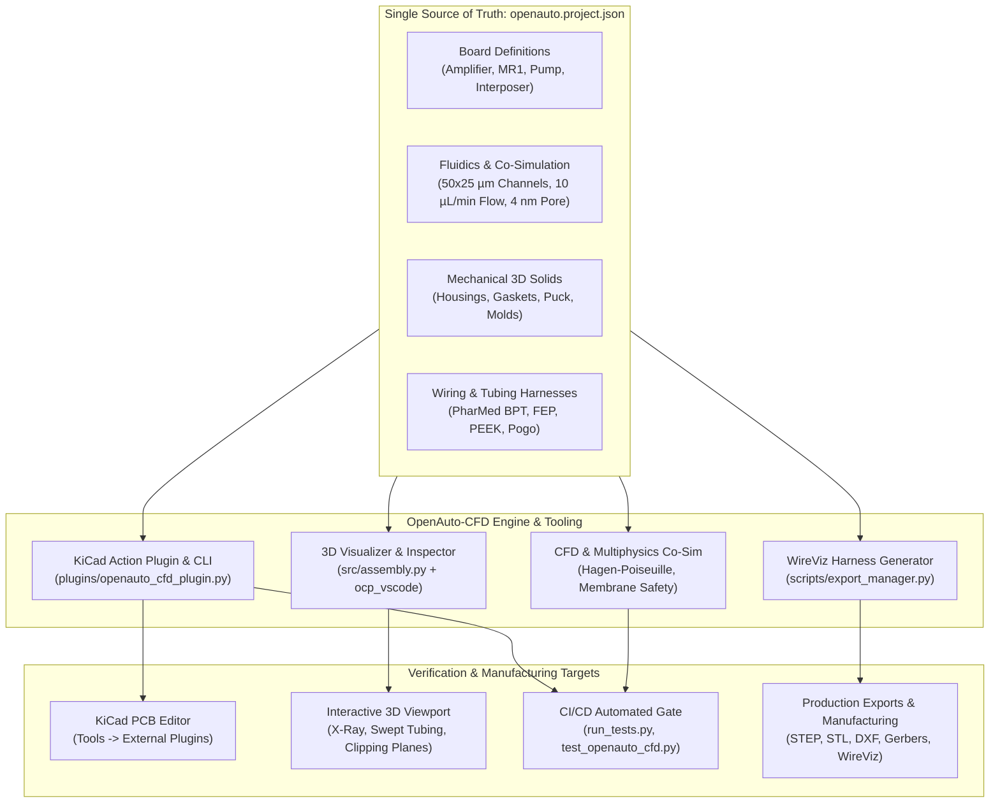

# OpenAuto-CFD: Co-Design Architecture, 3D Visualizer & KiCad Plugin Guide

**Document Version:** 1.0.0  
**Framework:** OpenAuto-CFD (Universal Configuration-Driven Multiphysics & CFD Optimizer)  
**System Target:** MR1 Nanopore Reader (Daemon Pore)  
**Primary Manifests:** [`openauto.project.json`](file:///home/loki/Projects/daemon-pore/openauto.project.json) / [`atlas.project.json`](file:///home/loki/Projects/daemon-pore/atlas.project.json)  
**KiCad Plugin & CLI Tool:** [`plugins/openauto_cfd_plugin.py`](file:///home/loki/Projects/daemon-pore/plugins/openauto_cfd_plugin.py)  
**3D Interactive Assembly Visualizer:** [`src/assembly.py`](file:///home/loki/Projects/daemon-pore/src/assembly.py)  
**Test Suite:** [`tests/test_openauto_cfd.py`](file:///home/loki/Projects/daemon-pore/tests/test_openauto_cfd.py)

---

## 1. Executive Summary

Solid-state and biological nanopore sequencing systems operate at the extreme boundary between nanoscale electrochemistry and microscale fluid dynamics. In the MR1 Nanopore Reader, a $10 - 20\text{ nm}$ thin silicon nitride ($\text{SiN}_x$) membrane is subjected to picoampere-level ionic current sensing while simultaneously enduring microfluidic buffer exchange, sample injection, and waste aspiration.

Historically, hardware development for such instruments suffers from severe engineering silos:
- **Electrical Engineers (ECAD)** design high-bandwidth, ultra-low-noise transimpedance amplifiers (TIAs) and multi-electrode Kelvin sensing arrays in KiCad without real-time awareness of mechanical channel dimensions, gasket squeeze, or port keep-outs.
- **Mechanical Engineers (MCAD)** model housings, compressive torque caps, and manifold plates in Build123d / OpenSCAD without automated geometric alignment to PCB Edge.Cuts contours, pogo contact heights, or ribbon cable egress.
- **Microfluidic Engineers (CFD)** simulate channel velocities, shear rates, and dead volumes in isolation, often discovering late that electrical traces or mounting screws penetrate fluid boundaries.

**OpenAuto-CFD** bridges these disparate domains into a unified, automated co-design framework. By centralizing all physical specifications into a structured project manifest ([`openauto.project.json`](file:///home/loki/Projects/daemon-pore/openauto.project.json)), OpenAuto-CFD drives:
1. **Multiphysics Co-Simulation:** Verifying fluid transport, hydrodynamic shear stress, trans-membrane burst pressures, and electrical translocation current.
2. **KiCad Action Plugin & CLI Verification:** Directly inspecting KiCad PCB Editor projects (`pcbnew`) and CI/CD pipelines to guarantee closed Edge.Cuts continuity, dimensional envelope limits, footprint net mappings, and port keep-outs.
3. **Interactive 3D Visualizer:** Providing real-time 3D CadQuery/Build123d visualization (`ocp_vscode`), photorealistic 360° orbital animations (`scripts/render_flythrough.py`), WireViz wiring/tubing schematics, and live browser oscilloscope telemetry.



---

## 2. Why OpenAuto-CFD? Engineering & Multiphysics Rationale

### 2.1 Hagen-Poiseuille Hydrodynamics & Low Reynolds Flow

Microfluidic flow in the MR1 cartridge operates deep in the creeping Stokes flow regime ($\text{Re} \ll 1$):
$$\text{Re} = \frac{\rho \cdot v \cdot D_h}{\mu} \approx \frac{1000\text{ kg/m}^3 \cdot 0.133\text{ m/s} \cdot 33.3\mu\text{m}}{1.0 \times 10^{-3}\text{ Pa}\cdot\text{s}} \approx 4.4 \times 10^{-3}$$

For rectangular microchannels ($w = 50\,\mu\text{m}$, $h = 25\,\mu\text{m}$, aspect ratio $\alpha = h/w = 0.5$):
- **Hydraulic Diameter ($D_h$):**
  $$D_h = \frac{2 w h}{w + h} = \frac{2 \cdot 50 \cdot 25}{50 + 25} = 33.33\,\mu\text{m}$$
- **Hydraulic Resistance ($R_{hyd}$):**
  For laminar flow in rectangular ducts:
  $$R_{hyd} \approx \frac{12 \mu L}{w h^3 \left(1 - 0.63 \frac{h}{w}\right)}$$
  At $L = 20\text{ mm}$ and standard $1.0\text{ M KCl}$ buffer viscosity ($\mu \approx 1.0\text{ mPa}\cdot\text{s}$), $R_{hyd} \approx 3.7 \times 10^{13}\text{ Pa}\cdot\text{s/m}^3$.

At nominal delivery flow rates ($Q = 10.0\,\mu\text{L/min} = 1.67 \times 10^{-10}\,\text{m}^3/\text{s}$), the viscous pressure drop is:
$$\Delta P = Q \cdot R_{hyd} \approx 6.18\text{ kPa} \approx 0.061\text{ bar}$$

### 2.2 Silicon Nitride ($\text{SiN}_x$) Membrane Burst Safety

Free-standing silicon nitride membranes used for solid-state nanopores have typical thicknesses of $t = 10 - 20\text{ nm}$ across windows of $a \times a = 50\,\mu\text{m} \times 50\,\mu\text{m}$.
The maximum burst pressure differential $\Delta P_{burst}$ is determined by the yield stress of amorphous $\text{SiN}_x$ ($\sigma_{yield} \approx 1.5 - 2.0\text{ GPa}$):
$$\Delta P_{burst} \approx 3.42 \cdot \sigma_{yield} \cdot \left(\frac{t}{a}\right)^2$$
For $t = 20\text{ nm}$ and $a = 50\,\mu\text{m}$ ($t/a = 4 \times 10^{-4}$):
$$\Delta P_{burst} \approx 3.42 \cdot (1.8 \times 10^9\text{ Pa}) \cdot (4 \times 10^{-4})^2 \approx 985\text{ Pa} \approx 9.85\text{ mbar}$$

> [!WARNING]
> Because the membrane rupture threshold ($\sim 10\text{ mbar}$) is **lower** than the total channel driving pressure ($\sim 60\text{ mbar}$), any asymmetric flow restriction or improper manifold porting will cause instantaneous wafer fracture.
> **OpenAuto-CFD co-simulation strictly verifies** that flowcell Cis and Trans channels are hydrodynamically balanced across the wafer gasket, preventing differential trans-membrane pressure spikes.

### 2.3 Dead-Volume Elimination & Acoustic Bubble Trapping

In nanopore electrical recordings, microbubbles trapped at channel corners or port transitions represent severe failure modes:
1. **Current Channel Blockade:** An air bubble entering the sensing chamber breaks the ionic continuity path, dropping baseline ionic current to $0\text{ pA}$.
2. **Parasitic Capacitance & Noise Modulation:** Meniscus vibration caused by pump pulsation modulates the cell capacitance ($C_m$), introducing broadband baseline noise ($> 50\text{ pA RMS}$) that obscures single-nucleotide translocation signals.
3. **Dead-Volume Analyte Retention:** Stagnant zones in cartridge corners prevent thorough flushing between experimental runs, leading to cross-contamination.

OpenAuto-CFD evaluates the flow velocity field $\vec{v}(x,y,z)$ and guarantees:
- Zero stagnation recirculation zones ($\vec{v} < 0.01 \cdot v_{bulk}$) near the active wafer aperture.
- Smooth $30^\circ$ and $45^\circ$ transitional fillets at fluidic inlets to eliminate bubble nucleation sites.
- Tight chamber volume control ($V_{chamber} = 12.5\,\mu\text{L}$), enabling complete buffer wash-out in $< 75\text{ seconds}$ at $10\,\mu\text{L/min}$.

### 2.4 Four-Electrode Kelvin Cell Integration

The PTFE Interposer board ([`Interposer/Interposer.kicad_pcb`](file:///home/loki/Projects/daemon-pore/Interposer/Interposer.kicad_pcb)) implements a 4-electrode Kelvin concentric sensing cell directly encircling the fluidic aperture:
- **Inner Sense Probes:** $r = 5.0 - 5.8\text{ mm}$ (`WS_CIS`, `RE_TRANS`)
- **Outer Current Drive Electrodes:** $r = 6.9 - 8.5\text{ mm}$ (`WE_POS`, `CE_GNDA`)
- **Perimeter Weep Detector:** Concentric perimeter moat (`WEEP_MOAT`)

OpenAuto-CFD enforces co-design clearance between the electrochemical sensing electrodes and the fluidic sealing gasket ([`exports/Gasket_Main_DXF.dxf`](file:///home/loki/Projects/daemon-pore/exports/Gasket_Main_DXF.dxf)), ensuring zero electrolyte leakage across the guard ring while maintaining sub-$10\text{ fA}$ dielectric isolation.

---

## 3. The 3D Visualizer Ecosystem: Interactive Co-Design Inspection

The repository includes a complete 3D visualization and simulation suite, enabling developers to interactively inspect mechanical clearances, fluidic tubing paths, and electrical interconnects before manufacturing.

### 3.1 Interactive 3D CadQuery / Build123d Visualizer (`ocp_vscode`)

The primary interactive 3D visualizer is implemented in [`src/assembly.py`](file:///home/loki/Projects/daemon-pore/src/assembly.py) using `ocp_vscode`.

#### How to Launch the Visualizer
You can launch the visualizer through any of the following convenient commands:

```bash
# Method 1: Using npm script
npm run visualize

# Method 2: Direct Python invocation (runs assembly and displays full stack)
.venv/bin/python src/assembly.py

# Method 3: Environment setup with visualizer flag
./install.sh --viewer
```

#### What You See in the Interactive Visualizer
When launched, `src/assembly.py` builds and renders the complete multi-layer instrument:
1. **Peristaltic Pump Base Module:** Bottom case, pump lid, stepper motor mount, and dual-roller tube track.
2. **Reader Housing & Tower:** Main reader base case and cylindrical threaded neck lid.
3. **Luer Bulkhead Panel Mounts:** 4× precision bulkhead fittings positioned at the side walls ($X = \pm 57.5\text{ mm}$, $Y = \pm 20.0\text{ mm}$, $Z = 17.0\text{ mm}$).
4. **Hexagonal Cartridge Stack (Bottom to Top):**
   - **Bottom Pusher Plate** ($Z = 30.0\text{ mm}$): Supporting bottom hex base.
   - **Plate 1 Base Hex** ($Z = 34.0\text{ mm}$): Fluidic routing plate with Trans channel.
   - **Fitted Amplifier Gasket** ($Z = 38.0\text{ mm}$): Precision molded elastomeric seal.
   - **Active Amplifier PCB / Interposer** ($Z = 38.8\text{ mm}$): Hexagonal PCB with pogo pins and Kelvin cell.
   - **Cast Nanopore Wafer Gasket** ($Z = 40.4\text{ mm}$): Encapsulating the $5\times 5\text{ mm}$ SiNx wafer.
   - **Plate 3 Top Hex** ($Z = 41.2\text{ mm}$): Top well plate with Cis channel.
   - **Pressure Puck** ($Z = 49.2\text{ mm}$): Load distribution piston with optical inspection window.
5. **Torque-Lock Cap Assembly:** Dual-shell screw cap with outer tactile finger ribs and calibrated internal flexure springs.
6. **3D Swept Tubing Harnesses:** Five microfluidic lines routed through bulkhead fittings and lid conduit channels:
   - `TUBE_PUMP`: Buffer reservoir $\rightarrow$ Pump intake (PharMed BPT, yellow).
   - `TUBE_FEED`: Pump discharge $\rightarrow$ Right-Front bulkhead $\rightarrow$ Cartridge Trans inlet (cyan).
   - `TUBE_TRANS_LINE`: Buffer supply $\rightarrow$ Left-Front bulkhead $\rightarrow$ Cartridge Cis inlet (green).
   - `TUBE_WASTE_1`: Cis outlet $\rightarrow$ Right-Back bulkhead $\rightarrow$ Waste vessel (blue).
   - `TUBE_WASTE_2`: Trans outlet $\rightarrow$ Left-Back bulkhead $\rightarrow$ Waste vessel (orange).
7. **Shielded Electrical Harnesses:** Gold pogo pins, twisted pair motor wiring, and 4-conductor shielded analog signal lines.

#### Visualizer Interactive Controls
- **Transparency / X-Ray Mode:** Visualizes internal fluid channels and gaskets embedded inside solid aluminum/delrin plates.
- **Clipping Planes:** Slice through the assembly along $X$, $Y$, or $Z$ axes to inspect internal O-ring compression and pogo pin contact deflection.
- **Exploded View Inspection:** Programmatically explode parts along the $Z$-axis to audit stack alignment.

### 3.2 WireViz Electrical & Tubing Harness Diagrams

OpenAuto-CFD orchestrates automated cable and tubing documentation via WireViz:
- **Electrical Harness Definition:** [`wiring/reader_wiring.yaml`](file:///home/loki/Projects/daemon-pore/wiring/reader_wiring.yaml)
- **Microfluidic Tubing Definition:** [`wiring/reader_tubing.yaml`](file:///home/loki/Projects/daemon-pore/wiring/reader_tubing.yaml)

#### Generating Harness Documentation
```bash
# Generate both electrical and tubing diagrams
npm run export:wiring
# Or via export_manager.py directly
.venv/bin/python scripts/export_manager.py --wiring
```
Outputs are staged to [`exports/reader_wiring/`](file:///home/loki/Projects/daemon-pore/exports/reader_wiring/):
- `reader_wiring.svg` / `reader_wiring.html` / `reader_wiring.png`
- `reader_tubing.svg` / `reader_tubing.html` / `reader_tubing.png`

### 3.3 Automated 360° Photorealistic Flythrough Orbit Animations

For automated regression inspection and documentation renders, [`scripts/render_flythrough.py`](file:///home/loki/Projects/daemon-pore/scripts/render_flythrough.py) renders high-resolution orbital videos:
```bash
# Run headless flythrough animation renderer (uses xvfb on Linux CI)
npm run render:flythrough
```
This renders a full $360^\circ$ rotating orbit around the entire reader and pump stack, exporting high-framerate `.webm`, `.mp4`, and animated `.gif` artifacts.

### 3.4 Live Browser Oscilloscope & Telemetry Portal

For live electrophysiological monitoring, the reader firmware includes a zero-dependency HTML5 Canvas Web Oscilloscope embedded directly in [`MR1_firmware/src/web/`](file:///home/loki/Projects/daemon-pore/MR1_firmware/src/web/):
- Accessible over local Wi-Fi or USB soft-AP (`http://192.168.4.1`).
- Streams real-time decimated $1\text{ kHz}$ current samples alongside full $100\text{ kSPS}$ USB streaming.
- Provides interactive gain, digital filter selection, and live baseline variance readout.

---

## 4. The KiCad Action Plugin & CLI Verification Engine

The OpenAuto-CFD KiCad Plugin ([`plugins/openauto_cfd_plugin.py`](file:///home/loki/Projects/daemon-pore/plugins/openauto_cfd_plugin.py)) delivers bidirectional ECAD-MCAD-CFD co-design verification. It operates both as an interactive **Action Plugin inside KiCad PCB Editor** and as a headless **Command Line Interface (CLI)** for CI/CD pipelines.

### 4.1 Architecture & S-Expression Engine

Unlike basic DRC scripts, the OpenAuto-CFD plugin features a native S-expression parser that analyzes KiCad PCB layouts directly:
1. **Edge.Cuts Boundary Continuity:** Extracts all `gr_line`, `gr_arc`, and `gr_rect` segments on the `Edge.Cuts` layer. Verifies that every segment endpoint connects to exactly one other endpoint, guaranteeing a 100% closed, leak-free mechanical contour with zero floating or unclosed lines.
2. **Dimensional Envelope Check:** Computes the exact bounding box $[X_{min}, Y_{min}, X_{max}, Y_{max}]$ and verifies board dimensions against tolerance targets:
   - **Amplifier & Interposer:** $55.004\text{ mm} \times 51.962\text{ mm}$ hexagonal boundary (tolerance $\pm 1.5\text{ mm}$).
   - **MR1 Motherboard:** $80.0\text{ mm} \times 60.0\text{ mm}$ rectangular boundary (tolerance $\pm 1.5\text{ mm}$).
   - **Pump Controller:** $88.0\text{ mm} \times 88.0\text{ mm}$ square boundary (tolerance $\pm 1.5\text{ mm}$).
3. **Netlist & Manifest Alignment:** Extracts all net names across pads, vias, and traces, normalizes hierarchical sheet prefixes (`/` and `>`), and confirms required nets defined in [`openauto.project.json`](file:///home/loki/Projects/daemon-pore/openauto.project.json) are present.
4. **Fluidic Port Keep-Out Clearance:** Verifies that electrical copper, high-voltage nets, and thermal vias maintain safe keep-out distances from central microfluidic well apertures and pogo pins.

### 4.2 Installing the Plugin into KiCad

The plugin installs into KiCad's user scripting directory with a single command:

```bash
# Method 1: Using the OpenAuto CLI
.venv/bin/python plugins/openauto_cfd_plugin.py --install

# Method 2: Using the environment setup script
./install.sh --install-kicad-plugin

# Method 3: Using npm
npm run openauto:install-plugin
```

The installer automatically detects your operating system and KiCad version (KiCad 10.0, 9.0, or 8.0):
- **Linux:** `~/.local/share/kicad/<version>/scripting/plugins/`
- **Windows:** `%APPDATA%\kicad\<version>\scripting\plugins\`
- **macOS:** `~/Library/Application Support/kicad/scripting/plugins/`

### 4.3 Using the Plugin in KiCad PCB Editor (GUI)

Once installed:
1. Open any project PCB in KiCad (e.g. [`Amplifier/Amplifier.kicad_pcb`](file:///home/loki/Projects/daemon-pore/Amplifier/Amplifier.kicad_pcb) or [`Interposer/Interposer.kicad_pcb`](file:///home/loki/Projects/daemon-pore/Interposer/Interposer.kicad_pcb)).
2. In the top menu bar, select:  
   **Tools $\rightarrow$ External Plugins $\rightarrow$ OpenAuto-CFD: Co-Design & Clearance Verifier**  
   *(or click the OpenAuto-CFD icon on the top action toolbar)*.
3. The plugin will execute immediately and display a verification dialog:
   - Green `[PASS]` indicator when all dimensional, boundary, and net checks succeed.
   - Bounding dimensions ($W \times H$).
   - Closed loop segment count and endpoint verification.
   - Summary of detected nets and manifest alignment.

### 4.4 Using the Standalone CLI (Headless / CI/CD)

The plugin can be run directly from terminal without launching KiCad:

```bash
# Validate all 4 boards in the project (Amplifier, MR1, Pump, Interposer)
npm run openauto:validate
# Or via Python directly:
.venv/bin/python plugins/openauto_cfd_plugin.py --validate-all

# Validate a specific board layout
.venv/bin/python plugins/openauto_cfd_plugin.py --validate Amplifier/Amplifier.kicad_pcb

# Synchronize Edge.Cuts dimensions back to openauto.project.json manifest
npm run openauto:sync
# Or via Python directly:
.venv/bin/python plugins/openauto_cfd_plugin.py --sync
```

#### Example CLI Validation Output:
```text
================================================================================
OpenAuto-CFD: Validating all project boards...
================================================================================

Validating board 'amplifier' (Amplifier/Amplifier.kicad_pcb)...
  Found 6 Edge.Cuts segment(s).
  Bounding Box: 55.004 mm x 51.962 mm
  Center: (164.500, 58.494) mm
  Edge.Cuts continuity: Closed loop confirmed (0 unclosed endpoints).
  Nets matched: 3
  Status: PASS

Validating board 'mr1' (MR1/MR1.kicad_pcb)...
  Found 1 Edge.Cuts segment(s).
  Bounding Box: 80.000 mm x 60.000 mm
  Center: (140.000, 100.000) mm
  Edge.Cuts continuity: Closed loop confirmed (0 unclosed endpoints).
  Nets matched: 1
  Status: PASS

Validating board 'pump' (Pump/Pump.kicad_pcb)...
  Found 8 Edge.Cuts segment(s).
  Bounding Box: 88.000 mm x 88.000 mm
  Center: (144.000, 144.000) mm
  Edge.Cuts continuity: Closed loop confirmed (0 unclosed endpoints).
  Nets matched: 1
  Status: PASS

Validating board 'interposer' (Interposer/Interposer.kicad_pcb)...
  Found 6 Edge.Cuts segment(s).
  Bounding Box: 55.004 mm x 51.962 mm
  Center: (164.500, 58.494) mm
  Edge.Cuts continuity: Closed loop confirmed (0 unclosed endpoints).
  Nets matched: 6
  Status: PASS

================================================================================
Summary: 4/4 boards PASSED OpenAuto-CFD verification.
================================================================================
```

---

## 5. The Hardware & Fluidic Manifest (`openauto.project.json`)

The manifest is organized into five top-level keys:

### 5.1 `boards`
Defines each printed circuit board, substrate physical properties, and co-design target interfaces:
```json
"boards": {
  "interposer": {
    "name": "PTFE Microfluidic Interposer Board",
    "path": "Interposer/Interposer.kicad_pcb",
    "schematic_path": "Interposer/Interposer.kicad_sch",
    "substrate": {
      "material": "PTFE / Rogers RO4350B",
      "er": 2.1,
      "loss_tangent": 0.0002,
      "thickness_mm": 0.8,
      "copper_finish": "ENIG"
    },
    "pogo_interface": {
      "target_ref": "J_POGO1",
      "pin_count": 6,
      "pitch_mm": 5.0,
      "contact_force_n": 0.8
    },
    "electrochemical_cell": {
      "configuration": "4-electrode Kelvin concentric",
      "inner_sense_radius_mm": [5.0, 5.8],
      "outer_drive_radius_mm": [6.9, 8.5],
      "aperture_window_mm": 6.2
    }
  }
}
```

### 5.2 `mechanical`
Catalog of all 3D solid parts generated by Build123d, their export paths, visualizer display colors, and optical opacity settings.

### 5.3 `fluidics`
Primary physical parameters governing flow rate, channel cross-sections, chamber volume, and buffer composition:
- `channel_width_um`: $50\,\mu\text{m}$
- `channel_height_um`: $25\,\mu\text{m}$
- `chamber_volume_ul`: $12.5\,\mu\text{L}$
- `flow_rate_ul_min`: $10.0\,\mu\text{L/min}$
- `buffer`: `1M KCl, 10mM Tris-HCl, pH 8.0`

### 5.4 `cosimulation`
Enables automated multiphysics co-simulation loops connecting fluid transport, membrane shear stress, and translocation current.

### 5.5 `harnesses`
Pointers to WireViz definitions for electrical (`wiring/reader_wiring.yaml`) and microfluidic (`wiring/reader_tubing.yaml`) lines.

---

## 6. Developer Quickstart & Command Reference

| Action | Command | Purpose |
| :--- | :--- | :--- |
| **Run All Unit & CFD Tests** | `python run_tests.py` | Runs complete 100-test suite including OpenAuto-CFD verification |
| **Run CFD Suite Directly** | `python -m unittest tests/test_openauto_cfd.py` | Verifies manifest, S-expression parser, CLI, and tubing |
| **Validate All KiCad Boards** | `npm run openauto:validate` | Headless verification of Edge.Cuts, dimensions, and nets |
| **Sync PCB Dimensions** | `npm run openauto:sync` | Updates manifest geometry from actual KiCad PCB Edge.Cuts |
| **Install KiCad Plugin** | `npm run openauto:install-plugin` | Copies plugin into active KiCad installation directory |
| **Launch 3D Visualizer** | `npm run visualize` | Opens interactive 3D assembly with x-ray and tubing |
| **Generate WireViz Diagrams** | `npm run export:wiring` | Compiles SVG/HTML electrical & fluidic wiring diagrams |
| **Render 360° Flythrough** | `npm run render:flythrough` | Renders photorealistic rotating orbital animation |
